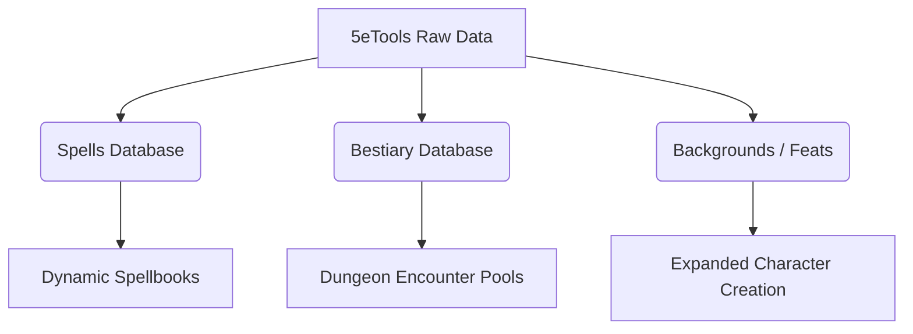

# 5eTools Raw Data Review & Import Plan

> Historical snapshot, not current priority or acceptance. See the
> [documentation map](README.md) for current authority. Findings, counts,
> gate decisions and execution orders below apply to the dated snapshot;
> reproduce relevant behavior before reopening a defect or reusing a claim.

This document reviews the newly added `5etools raw/class/` directory and outlines recommendations for importing other 5eTools datasets into the game engine.

---

## 1. Class Data Review

The raw class folder contains 14 files representing the core D&D 5e classes, plus Artificer and Mystic:

- **Core Martial/Spells**: `barbarian`, `bard`, `cleric`, `druid`, `fighter`, `monk`, `paladin`, `ranger`, `rogue`, `sorcerer`, `warlock`, `wizard`.
- **Additional**: `artificer`, `mystic`.

### Structure Analysis of 5eTools Class Files
The files are divided into two main tables:
1. `class`: Defines hit die (`hd`), saving throw proficiencies (`proficiency`), starting proficiencies, subclass headers, and the progression table (`classTableGroups` representing spell slots and level-by-level stats).
2. `classFeature`: Lists all class features (e.g. Spellcasting, Rage, Divine Sense), their levels, and descriptors.

### Mapping to Engine Class Format
We can convert these raw classes to our target format (`data/core/classes/`) using a Python script:
- **Hit Die**: Map `hd.number` to `"hit_die"` (e.g. `10` -> `"d10"`).
- **Saving Throws**: Map `proficiency` array to uppercase string array (`["str", "con"]` -> `["STR", "CON"]`).
- **Spell Slots**: Parse `classTableGroups` to extract the spell slot arrays for levels 1 to 5.
- **Features by Level**: Collect features from `classFeature` matching the class ID and index them by level (1 to 5).

> [!WARNING]
> While we can auto-import all descriptions and UI components of features, class features with active mechanical effects (like a Barbarian's *Rage* resistance or a Cleric's *Turn Undead*) will need custom code bindings in the combat actions script ([combat_action.gd](../src/combat/combat_action.gd)) to function in battle.

---

## 2. Additional 5eTools Datasets to Import

To fully build out the game's metagame and progression, we should import these additional 5eTools files:

### A. Spells (`spells/` or `spells.json`)
- **Why**: Spellcasters currently have limited spell selections. Importing the full SRD spellbook expands the tactical depth of Wizards, Clerics, and Bards.
- **Target Fields**:
  - `level` -> `level`
  - `school` -> `school` (mapped to full name: `E` -> `evocation`, etc.)
  - `range` -> `range` (normalized to hexes: feet / 5)
  - `entries` -> `description`
  - `damageInflict` -> `damage_type`
- **Engine Lift**: **Medium**. The spell data model in the game is already modular. Adding new spell JSONs will immediately populate the spell choices during level-ups, but custom spell effects (like teleportation or complex damage modifiers) must be supported by the combat engine.

### B. Bestiary (`bestiary/` or `bestiary.json`)
- **Why**: Allows campaign creators to define rich encounter pools for dungeon rooms.
- **Target Fields**:
  - `hp.formula` -> `hit_points` (verbatim dice formula, e.g. `2d8 + 4`)
  - `ac` -> `armor_class`
  - `speed.walk` -> `speed` (divided by 5)
  - `abilities` -> `ability_scores` (STR, DEX, CON, INT, WIS, CHA maps)
  - `action` -> `attacks` (extracting name, damage dice, attack bonus, and range)
- **Engine Lift**: **Low**. Monsters are loaded dynamically. A python script can parse 50+ SRD monsters directly into the engine, and the existing monster AI and grid controllers will run them out of the box.

### C. Backgrounds (`backgrounds.json`)
- **Why**: Adds starting skills and thematic choices during Character Creation.
- **Target Fields**:
  - `skillProficiencies` -> `proficiencies`
  - `startingEquipment` -> `starting_equipment`
- **Engine Lift**: **Low**. Relies on simple string mappings.

---

## 3. Implementation Plan

If we decide to proceed, the recommended development timeline is:

| Step | Scope | Estimated Effort |
| :--- | :--- | :--- |
| **Step 1: Class Converter** | Parse `5etools raw/class/` to generate standard classes (`fighter`, `cleric`, `wizard`, etc.) up to Level 5. | 2–3 hours |
| **Step 2: Spells & Bestiary Converter** | Process spells and bestiary files, exporting clean, modular JSON arrays. | 2–3 hours |
| **Step 3: Core Engine Bindings** | Update [combat_action.gd](../src/combat/combat_action.gd) to support the new spell effects and monster attacks. | 4–5 hours |
