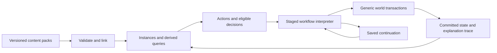

# Data-driven 2024 classes and subclasses: execution plan

> Working design specification. Direction accepted by
> [ADR-0018](../decisions/0018-shared-data-driven-rules-runtime.md), 2026-10-09;
> syntax, complete scope, phase sequence and suggested files remain proposals.
> The [roadmap](../../roadmap.md) chooses one shared runtime proof. Source
> observations/counts below are dated migration inputs, not live certification.

Date: 2026-10-09, America/Chicago. Status: **working specification**, not shipped behavior; ADR-0018 accepts direction only. Scope: the twelve 2024 Player's Handbook classes, their forty-eight subclasses, levels 1–20, multiclassing, and their mechanical dependencies. Artificer, Mystic, legacy subclasses, and later supplements are separate content packs.

The recommended architecture is a **small, typed rules language stored as JSON**, interpreted by a generic runtime. It combines pure queries, ordered resolution stages, bounded workflows, source-owned effects, and data-defined state machines. Classes and subclasses are grant containers. They do not select engine implementations. Spells, feats, maneuvers, invocations, forms, companions, equipment and conditions use the same language wherever their behavior interacts.

The central acceptance rule is: **a content author can add or change a class or subclass by changing its pack alone, including its actions, choices, resources, casting policies and interactions.** A new feature ID must never require an engine branch, resolver registration, save-field addition, UI case or availability allowlist. Renaming every content ID must preserve behavior after updating references inside the pack.

This requires more machinery than the existing bounded executor. That cost is justified by the owner's stated purpose: homebrew execution rather than a fixed game catalog. It is not justified by player count or theoretical scale.

## 1. Evidence, assumptions and the fidelity boundary

### What exists in this working tree

Inspected source and content, not just earlier architecture summaries:

| Starting material | Observed state | Treatment in the new model |
|---|---|---|
| `data/core/classes/` | Twelve in-scope files, plus Artificer/Mystic references. 244 top-level feature records across the twelve; some are resources or staged records. | Preserve identities, progression tables and authored choices; translate behavior clause by clause. Presence does not establish implementation. |
| `data/core/subclasses/` | Champion, Fiend Patron, Warrior of the Open Hand; 21 feature records, five explicitly disabled. | Starting examples and regression material, not proof of complete subclass support. |
| `_staging/staged/` | Forty-five additional subclass files; 305 records, 225 explicitly disabled. | Inventory and initial references. An enabled spell grant does not certify the surrounding subclass. |
| `_staging/extracts/5etools/by_subclass/` | Forty-eight XPHB requirements extracts, 309 raw feature entries including wrapper/nested entries. | Identify mechanics, references and source pages. Do not equate the raw entry count with independent features. |
| `src/characters/class_feature.gd` | Bounded operations and explicit Barbarian/Sorcerer special handling. | Salvage validation, owned-record checks and common effects. Replace content-specific runtime behavior. |
| `src/characters/class_progression.gd` | Shared entitlements, but named Wizard, Sorcerer, Warlock and other choice/save paths remain. | Generalize acquisition, choice validation, replacement and persistence. |
| `src/spells/shared_spell.gd` | Shared ordinary payloads; mixed attack/save delivery currently rejected. | Ordered steps are a direct precursor, not an optional later convenience. |
| ADR-0006 / ADR-0017 | The former deliberately retains class helpers; the latter requires shared spell composition. | ADR-0018 explicitly supersedes the helper exception for the target pack while retaining compatibility/source guarantees and extending shared-spell execution. |

Inventory details are in [the accompanying JSON inventory](data-driven-2024-class-inventory.json). Counts describe this working tree, not completion percentages.

### Sources of truth

The published 2024 rule text, applicable corrections and explicit table rulings determine behavior. Existing JSON determines migration input and flags discrepancies; it cannot override a conflicting rule while claiming fidelity. Preserve each original record and its source location during translation. Record conflicts instead of silently choosing the more convenient version.

Use the [SRD 5.2.1](https://media.dndbeyond.com/compendium-images/srd/5.2/SRD_CC_v5.2.1.pdf) for covered rules, and the actual PHB text for its other subclasses. The [official 2024 update roster](https://www.dndbeyond.com/posts/1810-updates-in-the-players-handbook-2024) identifies the four subclasses per class. The SRD alone is not the full forty-eight-subclass corpus.

The local extracts explicitly truncate prose, preserve only short table previews, and sometimes lose terms such as “Bonus Action,” “Hit Points” or spell names. There is no complete raw PHB class corpus in the inspected staging files. They are useful requirements aids, not sufficient source text for final certification. Complete source verification is therefore the first implementation deliverable, not something this report claims to have finished. Selected difficult rules were checked against publisher rules and licensed PHB compendium entries; the remaining rows below are architectural coverage targets.

### Assumptions and adaptations

| Assumption | Why chosen | If wrong |
|---|---|---|
| “All subclasses” means the forty-eight in the 2024 PHB. | Matches the existing forty-eight extracts and a finite acceptance target. | Add an explicit supplement/version manifest and expand the clause ledger. Never claim an unbounded future catalog is complete. |
| Reuse this Godot project. | Its current UI, combat boundaries and saves are valuable; changing languages creates unrelated work. | On another host, retain the JSON contract and behavioral fixtures; replace adapters and the interpreter implementation. |
| GDScript runtime; JSON authoring and persistence; Python inventory tools. | Fits the actual repository and permits headless production tests without a new dependency. | A standalone TypeScript or C# implementation is viable, but there must still be one authoritative runtime. Do not build a second Python rules engine as an oracle. |
| A human GM can supply adjudicated facts. | Illusions, Wish and social meaning depend on the fiction and judgment. | Fully autonomous play requires an additional world/meaning model and inevitably bounded interpretations. It cannot honestly promise complete tabletop equivalence. |
| Local, turn-based authoritative state. | Fits the current product. | Multiplayer adds command ownership and sequencing, not a second class-rule implementation. |

### What “no hardcoding” can and cannot mean

Engine code may implement arithmetic, typed storage, dice generation, spatial queries, staged execution, transactions and presentation of generic choices. Those are interpretation and world capabilities. The 2024 pack must define class restrictions, numerical progression, resource recovery, spell-list permissions, trigger predicates, stacking exceptions and feature modifications as data. Shared game policies that classes can modify—action budgets, roll handling, damage ordering, concentration, casting restrictions and effect combination—must expose data-defined definitions and extension points too.

An operation named `apply_moon_druid`, `resolve_cunning_strike` or `do_portent` is prohibited. A data-defined feature or procedure may be named after the rule. Engine dispatch can switch on `choose`, `roll`, `branch`, `modify`, `invoke`, `grant`, `transfer`, `spawn`, `transition` and similar generic instructions. It must not switch on class, subclass, spell or feature IDs.

The literal promise “every imaginable future homebrew needs no engine change” is impossible for a finite world API. A JSON definition cannot make an engine perceive sound propagation, model a new plane, or render a new physical interaction if those capabilities do not exist. A general-purpose language encoded in JSON cannot fix that either. The achievable promise is **every mechanic in the verified 2024 corpus, and new combinations or data programs using that world's capabilities, requires no engine change**. New mechanics can declare typed custom state and procedures. A new observable world capability may require one generic adapter/primitive, with a versioned capability requirement.

The line is a missing observable capability, not a difficult class feature or an unpopular one-off rule. Keeping a unique official feature in engine code would violate the target. Expressing its unique workflow in data is acceptable. If the owner instead wants a small fixed adventure, named helpers are cheaper; they sacrifice precisely the moddability requested here.

## 2. Architecture candidates, attacks and what survives

These are design counterexamples, not claims that prototypes were implemented.

| Candidate | Mechanics that break it | Specific failure | Reject / retain |
|---|---|---|---|
| **A. Progression tables plus passive stat deltas and active effect arrays.** | Relentless Rage; Cutting Words; Wild Shape. | A final stat bonus cannot intercept falling to zero HP, modify another creature's unresolved test, or preserve identity while selectively replacing a stat block. | Reject as the execution architecture. Retain level grants, threshold tables and simple passive calculations. |
| **B. A growing effect enum with trusted exceptional handlers.** | Mercy modifying Flurry; Moon modifying Wild Shape; Eldritch Knight modifying Attack; Archfey modifying Misty Step. | The handler becomes the true rule. New interactions demand more engine branches; JSON only chooses which hardcoded behavior runs. An enum entry named after every exception fails the owner's requirement even if loading is generic. | Reject the exceptional-handler escape hatch. Retain typed validation, shared costs, common effect operations and ownership. This is the useful limit of current ADR-0006. |
| **C. Pure declarative predicates / Datalog-style facts, evaluated to a fixed point.** | Portent; Soulknife Homing Strikes; reaction-dependent hits. | Rules need choice before a roll, a new roll after a miss, payment conditional on a changed outcome, and an irreversible result at a particular moment. A timeless fact system loses temporal order and can oscillate on replacements. | Reject as the only runtime. Retain pure prerequisite queries, dependency graphs and explanation of derived values. Do not add a separate Datalog product just to implement those queries. |
| **D. An unordered event bus plus modifiers.** | Arcane Ward; Shield and attack riders; chained reactions; once-per-turn damage. | “On damage” is too vague. Damage can be mitigated, absorbed or prevented; a provisional hit can become a miss. Listener registration order must not decide the rules. An owner-turn Boolean also incorrectly excludes effects on someone else's turn. | Reject unordered listeners. Retain events, source-owned modifiers and causal records; add named stages, scoped counters and resumable decisions. |
| **E. Everything is a data-defined state machine.** | Multiclass spell access, overlapping auras, attack substitutions, damage modifiers. | Possible in principle, but multiplying states for every combination makes content brittle. Derived values and independent effects should not be encoded as a global cross-product of states. | Reject a universal global machine. Retain small local machines for Rage, forms, held Inspiration, bonds and mode changes. |
| **F. Arbitrary Lua/JavaScript/GDScript per feature.** | It can encode the rules, but exposes uncontrolled mutation and host assumptions. | Authors must become engine programmers; save formats, costs, prompts and ordering become conventions rather than guarantees. Mod scripts can bypass the common pipeline. This relocates special cases without making them inspectable data. | Reject unrestricted scripts as the default contract. Retain bounded procedures, variables, branching and calls as typed data instructions. |
| **G. Chosen hybrid: pure queries + typed staged workflows + local state machines.** | Attack it with all of the above, then companions, spatial illusions, Wild Magic, multiclassing and reload during a decision. | It works only if stage schemas expose enough context, extension points are real, state is source-owned, and costs/results survive suspension. These are explicit build gates below, not assumed accomplishments. | Retain the hybrid as a provisional architecture. Amend the instruction set when the clause ledger finds a missing general capability; never substitute a named engine handler. |

The chosen design is a domain programming language. Calling it “data” does not remove programming complexity. It makes that complexity portable, constrained, inspectable, testable and editable without rebuilding the engine. Avoiding every conditional would make the requirement unattainable.

## 3. The chosen data model

### Definition records and runtime instances

Keep authoring definitions separate from mutable state. A definition has a stable namespaced ID, revision, source references, kind, display information, declared capabilities and typed parameters. The runtime has an instance ID and explicit links to owner, creator, controller, source grant and causal parent. These identities are often different: a projected ward belongs to the Wizard but protects someone else; a summoned creature can outlive control.

| Record | Required responsibilities |
|---|---|
| `pack` | Ruleset/version, language version, content hashes, dependencies, required host capabilities, explicit overrides and compatibility policy. |
| `class` / `subclass` | Prerequisites, starting versus multiclass grants, class-level progression, subclass slot and parent reference. Grant feature instances; contain no resolver identity. |
| `feature` / `option` / `procedure` | Parameters, predicates, granted definitions, actions, subscriptions, modifiers, local machines and reusable bounded workflows. Maneuvers, invocations and Metamagic options are ordinary option definitions. |
| `choice` | Candidate query, cardinality, prerequisites, duplicate policy, stable entitlement, acquisition/replacement window and dependency policy. Permanent, per-rest and per-activation choices share validation but have distinct persistence. |
| `resource` | Numeric pool or distinct tokens, capacity query, captured token payload, recovery rules, alternate costs and payment stage. A token can hold a pre-rolled number; a pool can carry a die-size parameter. |
| `action` | Actor, eligible context, target/option selection, action type, costs, ordered procedure, interrupt windows and presentation. Attack substitutions consume units within an action rather than inventing free actions. |
| `modifier` | Query/stage target, predicate, typed operation, scope, combination rule and explicit override relation. Change a value, a policy, a target set, an action child or a result at a permitted point. |
| `effect` / `state_machine` | Source-owned grants, state, transitions, expiration, counters, linked entities and subscriptions. Zero-capacity state can remain alive when the rule requires it. |
| `casting_profile` / `cast_permission` | Origin/ability, repertoire/preparation/book/list queries, capacity, replacement schedule, slot-source compatibility, components, ritual/at-will/limited casting and cast-local overrides. |
| `entity_template` / `relationship` / `projection` | Creature/object/zone definitions, owner-relative scaling, controller, initiative/command policy, form field replacement and lifetime. No separate monster-versus-character rule implementation. |
| `ruleset_policy` / `adjudication_request` | Shared timing/combination/casting policies; typed human decisions where fiction cannot determine one result automatically. |

Use dictionaries in authoring where stable names matter, arrays for ordered procedures, explicit tables for progression. Store quantities with units: feet, seconds, HP, dice, slots and attack units must not be interchangeable integers. Convert feet to a map representation at the adapter. A five-foot hex approximation must be named as an approximation, not hidden in “full fidelity.”

### Expressions and queries

Use a JSON expression tree, not `eval` or arbitrary formula strings. Permit constants, typed references, arithmetic, comparisons, Boolean combinations, conditional expressions, bounded collection queries, count/sum/min/max and table lookup with explicit threshold/default behavior. Class level, total character level, proficiency bonus, casting ability, slot level and an owner's level are distinct references.

Examples of proposed expression notation:

```json
{
  "capacity": ["level", "self", "core:monk"],
  "ward_maximum": ["add", ["mul", 2, ["level", "self", "core:wizard"]], ["ability_mod", "self", "INT"]],
  "limit": ["floor_div", ["level", "self", "core:druid"], 3]
}
```

Content IDs here are references inside data, not instructions to the engine. Every intrinsic such as `level`, `ability_mod` or `distance` has a documented typed API and dependency declaration. Queries have no side effects or dice rolls. Cycles in derived-value dependencies fail validation; evaluate a directed graph rather than repeatedly running arbitrary rules until they appear stable.

Unknown or unavailable world facts are a typed `unknown`, not false. A procedure must obtain an adjudication or refuse with a precise unmet capability before spending costs. This matters for “can see,” willingness, qualifying enemy, observed illusions and missing material components.

### Instructions and reusable procedures

The initial interpreter needs these instruction families, implemented only when a real rule drives them:

| Family | Contract |
|---|---|
| `let`, `branch`, `choose`, `for_each` | Bind typed values; branch; suspend for a typed choice; iterate over a finite snapshot. No unrestricted `while`, dynamic code or recursive procedure calls. |
| `roll`, `test`, `invoke` | Use recorded RNG; run the shared D20 workflow; call a named data procedure/action/spell with explicit context and inherited policies. |
| `reserve`, `spend`, `release`, `transfer` | Operate on resources, action budgets, attack units, inventory copies or token identities at a declared payment stage. |
| `modify`, `replace`, `grant`, `remove` | Propose permitted stage changes, override declared values, create source-owned effects or remove qualified sources. Never mutate arbitrary host fields. |
| `transition`, `schedule`, `mark` | Change local state; set exact deadlines; record consumption against a defined scope identity. |
| `spawn`, `despawn`, `bind`, `project`, `move` | Use generic world entities and relationships; apply reversible projections; route movement through common legality and entry events. |
| `adjudicate` | Suspend for a constrained GM decision with recorded facts/results, then continue through the same effects and costs. |

Damage, healing, casting and attacks are public data procedures over these instructions, with stable stage contracts. They may use generic host settlement primitives, but the host must not reapply class bonuses or independently decide class exceptions. Composite procedures have typed inputs/results and statically known writes.

Macros are data-defined reusable procedures with typed parameters, expanded or linked at load time. A macro called `core:sneak_attack` is fine; a native opcode with that name is not. Unique features can be unique procedures. Do not insist that every feature become a reusable abstraction.

### Features modifying other features

Give public definitions **named parameters and extension slots**. Flurry exposes its strike sequence, eligible substitutions, inherited costs and use scope. Wild Shape exposes form eligibility, field-retention policy, AC candidates, temporary HP, casting restrictions and expiration policy. Attack exposes attack units and substitution permissions. A spell invocation exposes its effective school, casting time, components, origin, target set, concentration and payload parameters.

A modifying feature declares the referenced definition/slot, its predicate and a typed contribution. Mercy supplies healing substitutions into Flurry; Moon changes named form parameters; Archfey supplies Misty Step cast modes and post-cast effects. No patch uses a JSON array index or blindly edits another pack's object tree.

Imports declare required slot versions. Compatible additions combine through a named policy; incompatible replacements fail load unless an explicit pack override or applicable ruleset ordering resolves them. “Specific beats general” is an explicit override relation, not a sorting algorithm based on prose length. Stable ID sorting may order presentation, but never decides a rules conflict.

A mod can publish new extension slots or its own replacement definition as data. Freeze the verified 2024 pack's public slots before announcing a stable modding API; version deliberate breaking changes.

### Combination policies

Model contribution operators such as add, maximum, minimum, choose-one, replace, intersect and union. The relevant ruleset definitions choose the operator; the engine merely implements it. Examples include choosing a valid AC formula, keeping the highest nonstacking Extra Attack count, canceling Advantage/Disadvantage, nonstacking same-effect bonuses and source-specific condition removal. Similar wording is not enough to infer the same stacking rule.

Decisions whose ordering matters go to the controller specified by the ruleset's simultaneous-effects policy. Dependent operations declare `before`/`after` relations; reject cyclic ordering. Competing roll replacements receive an explicit decision and reevaluation, not both an arbitrary priority number and silent overwrite.

### Choices and progression

Store class levels by source, an ordered acquisition ledger and earned entitlement instances. A grant key contains the source instance, progression milestone and slot, so level-up applies once. Reconstruction rebuilds derived membership without replaying permanent changes.

A level-up or replacement is a transaction: propose the complete selection, evaluate prerequisites against the proposed result, validate dependent choices and commit all changes together. A Warlock invocation used as another invocation's prerequisite cannot simply disappear. A ruleset can prohibit that replacement or permit an explicit dependent replacement transaction when the rule allows it. Do not implement cascading removals as an undocumented convenience.

Choices record when they were legal and their rule-defined ongoing dependency policy. Losing a temporary prerequisite must not automatically revoke a previously earned feat unless the rules require it. Do not reevaluate every acquisition condition as a continuous condition.

Keep starting-class equipment, starting-class proficiencies and multiclass gains distinct. Features use class level, cantrip scaling may use character level, and subclass levels follow the parent. Spell preparation eligibility follows that casting source's own progression, not the character's combined slot capacity.

### Resources and timing

Resources support additive recovery, refill, restore-to-minimum, reset a counter, refresh a token collection and outcome-conditional expenditure. Schedules include rest start/completion, initiative, current turn, owner turn, effect instance, campaign deadline and triggered conversion. “Once per turn” is keyed to the encounter's current turn identity; “on each of your turns” additionally checks ownership. Per-target-per-turn, once-per-Rage and once-per-rest have separate keys.

Reservations guarantee affordability without implying expenditure. A die rolled provisionally is stored even if it is not ultimately consumed. A procedure declares whether payment occurs on declaration, roll, hit, successful improvement or completion. Refusal/cancellation before the rule's commitment spends nothing; cancellation after a paid roll does not rewind known dice or committed results.

Durations refer to exact events: start/end of the source's next turn, target's turn, current turn, rest or an absolute campaign time. Store anchor IDs and occurrence numbers, not “two rounds.” If an anchor ceases to exist, use an explicit lifecycle policy. Encounter exit/reentry has a defined conversion to campaign time; do not restart durations on entry or silently invent turns during exploration.

Recovery and scheduled effects consume event identities once. Loading cannot pretend a rest just happened. Advancing time in an unloaded room must either evaluate relevant scheduled effects or request the same recorded adjudication; it must not depend on having a rendered actor.

### Spellcasting is permission plus invocation, not a caster enum

A character can own multiple casting profiles. Each spell choice/permission retains its origin and ability even when a compatible slot from another pool pays for it. Spellbook acquisition, prepared capacity, one-at-level replacement, long-rest preparation, ritual permissions and automatic preparation are separate data rules.

Slot pools are generic resource collections with level and refresh metadata. A ruleset aggregates ordinary multiclass contributions using per-source rounding data. Pact slots stay separate but can pay for permitted cross-source casts. Arcanum and other limited free casts are permissions with their own uses, not fabricated ordinary slots. A depleted pool does not remove preparation eligibility.

Metamagic modifies a **cast instance**, not the global spell definition. Eligibility queries see structured spell properties and effective changes at the relevant stage. Combination restrictions, cost reductions and exclusions belong in option data. Child casts retain caster, origin, effective level, payment source, component exemptions and causal links. Table-generated spells can exclude Metamagic/Concentration only when the table's data explicitly says so.

The 2024 one-slot-per-turn rule is a shared policy observing actual expenditure during that turn, not an old Bonus Action spell heuristic. Attack-action substitutions must be distinguished from taking the Magic action; Action Surge restrictions must apply to the action actually granted. Exact interaction judgments belong in the clause ledger and fixtures, not an improvised blanket “cannot cast” flag.

## 4. How the engine consumes the data

### Load and activate

1. Resolve the existing content manifest's dependency/override graph. Preserve current conflict failures; extend it with language/API requirements and immutable pack hashes. Do not let file enumeration order select a winner.
2. Validate record shape, units, expression types, references, procedure signatures, write permissions, extension-slot compatibility and finite iteration. Resolve source locations for diagnostics. Unknown operations or unsupported required host capabilities reject activation.
3. Build indexes of grants, query dependencies and subscriptions by stage. Link data procedures and extension slots. Interpretation of a validated tree is sufficient initially; bytecode/JIT compilation is not a prerequisite.
4. Construct actor feature instances from progression and committed choices. Derive actions and subscriptions from those instances, without consulting a class whitelist. Inactive/disabled reference definitions remain inspectable, but cannot advertise usable actions.
5. Generate the UI from action and choice definitions. AI submits the same validated commands. A modded targeted feature, reactive feature or companion command must become available through the ordinary controls without a new button implementation.



### Resolve a command

The runtime accepts an owned action instance and inputs, not a caller-supplied feature body. It queries current legality, collects choices, reserves required costs, and advances the action's data-defined procedure. Each stage exposes a typed context and allowed transformations. UI callbacks only return choices; they never settle effects.

An event carries `event_id`, `parent_id`, `root_command_id`, source/caster/actor/target IDs, current turn ID, phase, effective action/spell properties and step-local results. A weapon attack that invokes a spell can retain both the Attack action parent and the child spell's casting origin. These facts cannot be collapsed to one `is_spell` flag.

Suggested public stage vocabulary, to be finalized by the first stress tests:

| Pipeline | Stage requirements |
|---|---|
| D20 test | Prepare context → before rolling → resolve roll mode/replacements → record dice → after dice/before outcome → provisional outcome → outcome-dependent choices/rerolls → final result. Each feature binds to the rule's actual window. |
| Attack | Declare attack/targets → resolve test → provisional hit → hit-changing defenses → final hit → select/precompute damage and riders → roll damage → damage settlement → after-hit/after-damage follow-ups. Only eligible final results unlock dependent payloads. |
| Damage | Build typed components → save/outcome transformations → bonuses/reductions in the declared order → resistance/vulnerability → interception/absorption → temporary HP/HP settlement → concentration/zero-HP/death processing → completed-damage triggers. Particular reductions bind to the proper stage instead of sharing one catchall. |
| Cast | Select permission/payment/parameters → validate targets/components → declare/commit required costs → interrupt window → ordered payload steps → outcome-conditional payment/refund → cast completion. Feature wording determines whether a subscription observes declaration, resolution or completion. |
| Movement | Select path/destination/mode → validate space → departure/entry events per actual travel → arrival. Teleports have separate semantics; they do not fabricate distance traveled. |
| Lifecycle | Rest start/completion, initiative roll, turn start/end, condition/equipment changes, time advance, entity removal and encounter transitions. |

The stage order and modifiable policies are definitions in the ruleset pack. The runtime implements stage suspension, type safety and invocation. It does not impose a native class-specific damage order. Hosts may provide atomic HP/resource/world updates; the ruleset decides when those updates happen.

**Verified discriminator:** in 2024, Arcane Ward and Projected Ward apply the protected creature's resistance/vulnerability before ward absorption. A generic pipeline copied from an older implementation can therefore be wrong even when it has an “absorb damage” operation. Check that rule in the [2024 Abjurer text](https://roll20.net/compendium/dnd5e/Subclasses:Abjurer?expansion=32231&iframe=true).

Reactions nest as child workflows. After a child changes AC, damage or other relevant state, reevaluate the parent's affected result and remaining eligibility. Do not emit a final hit, apply its rider, then attempt to undo it after Shield or Illusory Self. Simultaneous optional abilities are gathered into a decision window; selecting one can invalidate another, so refresh the candidates after each choice.

### Commit and suspension semantics

Use small explicit commit boundaries, not one rollback encompassing an entire combat action. Reserve before targeting/confirmation when needed. Commit declaration costs when the rule requires them. Commit a step's actual outcome once, then resume later steps. A later canceled movement choice cannot undo already dealt damage; a canceled target choice before any commitment cannot spend a slot.

An outcome-conditional cost is a provisional reservation until its outcome is known. Its definition says whether a failed outcome releases the reservation, refunds an earlier commitment or never spends in the first place. These are distinct causal records, even when the final pool balance matches. Their treatment by a turn's slot-expenditure policy must be tested against the rule rather than inferred from final arithmetic.

Within a commitment, validate and buffer the complete mutation set before applying it atomically. A chosen replacement, its token expenditure and its usage mark commit together. Compound writes cannot leave a free replacement, a spent-but-unused token or a half-created companion if validation fails. Automatic subscriptions observe committed facts; interrupt subscriptions can contribute proposals to the pending stage. This distinction prevents half-applied state from becoming a trigger.

Store a continuation with workflow/version ID, step cursor, typed local values, event stack, pending choice, reservations, committed step IDs and recorded random results. A suspended choice resumes the next eligible operation; it never rerolls previously visible dice or replays a completed grant. Changing a target requires reevaluation of that stage's legality, not reexecution of the whole root command.

The explanation trace should answer: “Which source supplied this bonus?”, “Why can I choose this?”, “Why did this resource spend?”, and “What made the form end?” Store enough structured causes for diagnostics and player summaries. A full event-sourced database is unnecessary: save state snapshots plus any pending continuation, with a bounded trace for debugging.

### Cycles and runaway content

Pure query dependencies and direct procedure calls must be acyclic. Event-driven workflows can schedule later events, so static checks alone cannot prove every mod terminates. Each subscription declares its repeat scope and causal eligibility. Do not suppress every child event: that would incorrectly disable legitimate triggered casts and subclass riders.

Flag suspicious causal cycles at load; require an explicit rule that breaks or governs them. Use a host execution budget to suspend with a diagnostic and recorded continuation, never to silently omit legal effects. Repeated damage reflection, recursive random-table results and effects triggering their own resource changes are mandatory malicious/accidental-mod fixtures. Valid nested reactions must remain legal. The GM can resolve an actual rules loop through a generic adjudication request rather than an engine special case.

### Persistence and world adapters

Save a generic envelope for entity IDs, progression/choice ledger, source-owned effect/machine instances, declared typed custom state, resource pools/tokens, relationships, deadlines, scoped usage marks, active controllers and pending workflows. Persist captured die sizes/DCs where a grant snapshots them; query live values only where the rule uses live values. An Inspiration die already handed to another creature must not silently resize because the Bard leveled up.

Restore through preflight into a temporary session: validate all definitions/hashes, instance references, typed values, clocks and continuations before replacing managers. Rebuild derived queries/subscriptions without firing acquisition, rest or activation events. Missing/changed content fails safely with the original save preserved and a named incompatibility. A compatible migration must be declared and tested; never silently clamp away meaningful tokens or selections.

The current schema-2 and legacy save boundaries are valuable. New interpreter state will likely need an explicit schema revision; do not force it into current fields merely to avoid a version number. Keep old files readable through the existing path. Plan an explicit, copy-preserving 2024 schema-2 conversion only after field mapping is proven. Historical final ability scores cannot always be decomposed into base scores and earned grants; retain a declared historical grant snapshot or request correction rather than guessing and double-applying improvements. No automatic legacy-rules conversion.

Combat and exploration use the same actor/effect state. Adapters supply positions, sight, inventory identity, bodies, object geometry and clocks. Class behavior must not live in these adapters. The present room/creature/form foundations are bounded and are not evidence of full world capability. A bridge created by Illusory Reality needs an object that actually supports movement, an expiry event, and its prohibitions enforced through descendant effects; a floating descriptive label is insufficient.

## 5. Concrete authoring examples

**All syntax below is proposed, not accepted by the current loader.** The fragments illustrate the intended contract; they are not complete class definitions. A reference to a `core:` procedure or slot assumes that definition is present in the linked ruleset pack. `$name.path` denotes a typed reference into the subscription/action context or a local binding. Expression arrays call the typed intrinsics described above. The compiler must resolve every reference and slot before enabling the record.

### Simple case: a passive feature and progression

```json
{
  "id": "core:champion",
  "kind": "subclass",
  "parent": "core:fighter",
  "grants": [
    {"at_class_level": 3, "definition": "core:champion_critical"},
    {"at_class_level": 15, "definition": "core:champion_superior_critical"}
  ]
}
```

```json
{
  "id": "core:champion_critical",
  "kind": "feature",
  "modifiers": [{
    "slot": "core:attack.critical_threshold",
    "when": ["in", "$test.attack_kind", ["literal", ["weapon", "unarmed"]]],
    "contribution": {"operator": "minimum", "value": 19}
  }]
}
```

The superior version supplies 18 through the same slot. The engine knows neither Champion nor those thresholds. This is the easy case; passing it alone proves little.

### Stateful resource: pre-rolled Portent tokens

```json
{
  "id": "core:portent",
  "kind": "feature",
  "parameters": {"token_count": 2},
  "resources": [{
    "local_id": "foretellings",
    "kind": "tokens",
    "payload": {"number": "integer:1..20"}
  }],
  "subscriptions": [
    {
      "stage": "core:rest.completed",
      "when": ["and", ["eq", "$event.actor", "self"], ["eq", "$event.rest_kind", "long"]],
      "procedure": [
        {"op": "remove", "resource_tokens": "self.foretellings", "selector": "all"},
        {"op": "for_each", "items": ["indices", "$parameters.token_count"], "as": "i", "do": [
          {"op": "roll", "dice": {"count": 1, "sides": 20}, "bind": "foretelling"},
          {"op": "grant", "resource_token": "self.foretellings", "payload": {"number": "$foretelling.total"}}
        ]}
      ]
    },
    {
      "stage": "core:d20.before_roll",
      "when": ["and", ["can_see_or_is_self", "self", "$test.actor"], ["unused", "self", "current_turn", "replacement"]],
      "procedure": [
        {"op": "choose", "controller": "self", "from": ["tokens", "self.foretellings"], "optional": true, "bind": "token"},
        {"op": "branch", "if": ["present", "$token"], "then": [
          {"op": "reserve", "token": "$token.id", "bind": "reservation"},
          {"op": "modify", "slot": "core:d20.pre_roll_replacement", "value": "$token.payload.number"},
          {"op": "spend", "reservation": "$reservation"},
          {"op": "mark", "owner": "self", "scope": "current_turn", "key": "replacement"}
        ]}
      ]
    }
  ]
}
```

`self` resolves to this feature's owning actor. The slot declares how a pre-roll replacement combines with test modifiers/roll modes, and the decision window settles competing replacements before payment commits. Greater Portent modifies the exposed `token_count` parameter; it does not install another engine path. Tokens get distinct identities even when numbers match. The [2024 Portent rule](https://roll20.net/compendium/dnd5e/Subclasses:Diviner?expansion=32231) specifically requires advance choice and limits replacement per turn; a generic post-roll bonus cannot represent it.

### Conditional payment: Homing Strikes

Conceptual procedure: subscribe after a qualifying blade attack provisionally misses; reserve one energy die; roll and add its result to that attack's pending test; recompute the outcome; spend only if it becomes a hit; otherwise release. Retain the rolled value in the continuation in either case. The runtime's reusable `improve_test` procedure accepts the eligible test query, die resource, operation and payment predicate.

```json
{
  "id": "core:homing_strikes",
  "kind": "feature",
  "subscriptions": [{
    "stage": "core:attack.provisional_outcome",
    "when": ["and", ["eq", "$attack.actor", "self"], ["eq", "$attack.outcome", "miss"], ["has_origin", "$attack.weapon", "core:psychic_blades"]],
    "invoke": {
      "procedure": "core:improve_test",
      "arguments": {
        "test": "$attack.test",
        "resource": "core:soulknife_energy",
        "die": ["resource_parameter", "self", "core:soulknife_energy", "die_size"],
        "operation": "add",
        "payment_when": ["eq", "$improved.outcome", "hit"]
      }
    }
  }]
}
```

The rule remains a data program composed from generic reservation/roll/modification instructions. Do not implement `core:improve_test` as a native shortcut that conceals eligibility or payment. Fighter Tactical Mind is another stress test for conditional use expenditure; Psi Warrior and Soulknife must not be merged merely because both call their pool “Psionic Energy.”

### Feature modification: Mercy changes Flurry

```json
{
  "id": "core:mercy_flurry_upgrade",
  "kind": "feature",
  "extensions": [{
    "definition": "core:flurry",
    "slot": "strike_substitutions",
    "contribution": {
      "action": "core:hand_of_healing",
      "replaces": {"unit": "unarmed_strike", "count": 1},
      "permission": {
        "cost_overrides": [{"cost_key": "healing_focus", "amount": 0}],
        "usage_gate": "core:mercy_flurry_upgrade_uses"
      }
    }
  }]
}
```

The full definition must also encode the upgrade's Hand of Harm behavior, level-specific permissions and use schedule from the unabridged source. This fragment intentionally demonstrates only the healing substitution. The override is confined to the child action inside the qualified Flurry invocation; it does not make every use of Hand of Healing free. This contextual exception is a stronger extensibility test than another damage type.

### Rage and its replacements

Represent Rage as a local machine with an active state, an absolute maximum deadline and an exact source-next-turn-end deadline. Activation checks armor, spends a use/Bonus Action, removes Concentration through the shared policy and grants effects. Enemy attack-roll and forced-save events extend the deadline when eligible; a separate Bonus Action can extend it without another use. Equipment and condition changes can end it. Persistent Rage changes the duration-maintenance and early-end policy through declared slots; World Tree and Wild Heart attach their choices/effects to this instance. Do not assume an attack must hit, that extension costs a use, or that every upgraded Rage retains the base Incapacitated termination predicate.

The base behavior is checked against the [2024 Barbarian rules](https://www.dndbeyond.com/sources/dnd/br-2024/character-classes). The complete state-machine definition belongs in the first vertical slice, including its out-of-combat clock and save/reload behavior.

### Casting profiles: same slots, different permissions

The following profile fragments show the separation needed for Wizard and Warlock. Referenced tables, list queries, book procedures and replacement-window policies are data definitions to translate from the existing records and complete source. They are not new native caster enums.

```json
{
  "id": "core:wizard_casting",
  "kind": "casting_profile",
  "origin": "core:wizard",
  "ability": "INT",
  "repertoire": {"collection": "self.wizard_book", "acquisition": "core:spellbook_acquisition"},
  "preparation": {
    "candidates": "core:eligible_wizard_book_spells",
    "capacity_table": "core:wizard_prepared_progression",
    "replacement_window": "core:wizard_preparation_windows"
  },
  "ordinary_slot_contribution": "core:full_caster_contribution",
  "payment_compatibility": "core:ordinary_and_pact_slot_payment",
  "additional_permissions": ["core:wizard_book_ritual_permission"]
}
```

```json
{
  "id": "core:warlock_casting",
  "kind": "casting_profile",
  "origin": "core:warlock",
  "ability": "CHA",
  "preparation": {
    "candidates": "core:eligible_warlock_list_spells",
    "capacity_table": "core:warlock_prepared_progression",
    "replacement_window": "core:one_spell_on_warlock_level"
  },
  "granted_resource": "core:pact_slots",
  "payment_compatibility": "core:ordinary_and_pact_slot_payment"
}
```

Always-prepared grants carry a profile origin and whether they consume capacity. An Arcanum is a separate selected-spell cast permission, with a per-permission use and allowed replacement window. A multiclass actor can pay a Wizard permission with a compatible Pact slot while retaining Intelligence and the Wizard origin. The profile's query uses its class progression for spell eligibility; it does not inspect the combined slot pool as a shortcut.

### Form modification: Moon changes Wild Shape parameters

```json
{
  "id": "core:moon_circle_forms",
  "kind": "feature",
  "extensions": [
    {
      "definition": "core:wild_shape",
      "slot": "maximum_form_cr",
      "contribution": {"operator": "replace", "value": ["floor_div", ["level", "self", "core:druid"], 3]}
    },
    {
      "definition": "core:wild_shape",
      "slot": "form_ac_candidates",
      "contribution": {"operator": "maximum", "value": ["add", 13, ["ability_mod", "self", "WIS"]]}
    },
    {
      "definition": "core:wild_shape",
      "slot": "temporary_hp_grant",
      "contribution": {"operator": "replace", "value": ["mul", 3, ["level", "self", "core:druid"]]}
    }
  ]
}
```

The referenced Wild Shape procedure owns known-form selection, remaining eligibility predicates, costs, field projection, end policy and equipment decisions. Moon changes only these declared parameters. Its in-form spell permission is a separate feature querying spells granted by the Moon spell feature; it does not remove the entire casting restriction. The generic projection retains the actor's identity and authoritative HP/resources while supplying the permitted form fields and attacks. Ending it removes that projection's contributions rather than restoring a whole stale Character snapshot.

## 6. The hardest mappings and adversarial acceptance cases

These mappings name the information the model must carry. They are not replacements for the rule text or a certification that the engine currently supports them.

| Mechanic | Data representation | Test designed to break the representation |
|---|---|---|
| **Sneak Attack and Cunning Strike** | Eligibility query over attack/weapon/Advantage/nearby creatures; turn-scoped rider; exchange damage-die units for option procedures before rolling; later features change option count/catalog. | Apply on an eligible Reaction during someone else's turn; reject Disadvantage where required; distinguish die costs from rolled damage and critical doubling; multiple save/condition/movement results remain independent. |
| **Bardic Inspiration, Lore and Valor** | A held source-owned token with captured die/expiry; consumption permissions extended by subclass; a decision window at the specified test or hit stage. | Bard levels after granting; two Bards try grants; a pending roll becomes success; a provisional hit becomes miss; the recipient's Reaction rather than giver's budget pays where required. |
| **Arcane Ward and Projected Ward** | Source-owned capacity effect with current/max HP and active-even-at-zero lifetime; qualified casting restores it; interception at a declared damage stage; projection spends the owner's Reaction. | Resistant ally takes 20 damage, ward has 7 HP: apply resistance once, spend 7 ward HP, send 3 HP to the ally; do not halve twice. Zero ward persists. Concentration sees actual damage to the creature. Failed Counterspell payment/refund cannot duplicate recovery. |
| **Portent / Greater Portent** | Pre-rolled token collection; pre-roll replacement; exposed count parameter; current-turn use gate. | Two equal rolled numbers are distinct tokens; no post-roll selection; spending on another creature's turn is legal; reload cannot reroll unused tokens or reuse a consumed one. |
| **Beast Master companion** | A creature template, owner-relative scaling and bond; acts within owner's turn; independent movement/Reaction; command permission consumes either owner's Bonus Action or an Attack unit; upgrades add child actions. | Commanding cannot consume the beast's action twice or create an extra ranger attack. Incapacitation changes autonomy. Owner death and replacement obey bond policies. Share Spells preserves casting source and spends once. |
| **Wild Shape / Moon** | Reversible field projection on the same actor, a retained-state policy, form-choice query and generic attacks; subclass modifies CR/AC/temporary HP/casting permissions. | No 2014 separate beast-HP pool. Ending form does not restore previously spent slots or lost HP. Known forms and flight eligibility still gate choices. Moon spell permissions do not permit every spell. Saves restore the correct identity and inventory choices. |
| **Stars / Sea** | Alternate uses of the same Wild Shape pool; machine mode and turn-stage transitions; caster-relative zones with controller, source and lifetime. | A constellation switch updates grants once; a gifted emanation distinguishes owner, bearer and beneficiary; moving or ending the source updates the area through the same path in combat/exploration. |
| **Eldritch Knight / Valor / Mercy** | Action units and typed replacement permissions; nested child invocation with locally overridden costs and action classification. | Cantrip/spell/healing substitutions must consume exactly the declared attack/strike units. Multiclass Extra Attack does not sum. Action Surge's Magic-action restriction cannot be turned into a class-specific casting ban. |
| **Warlock invocations / multiclass casting** | Choice dependencies, per-source repertoire/ability, shared contribution policy, separate Pact slots and limited cast permissions. | Higher combined slots do not unlock higher Wizard preparations. Pact slot payment does not change casting ability/origin. Replacing a prerequisite invocation fails safely. Arcanum cannot become a fungible upcasting slot. |
| **Metamagic / Aberrant / Archfey / Great Old One** | Cast-local parameter transformations and permission alternatives; data-defined combination/exclusion policies; child casts with causal identity. | Psionic payment does not alter all future versions of the spell. A Misty Step rider recognizes every allowed casting permission, not only one ID path. A reduced-Concentration summon changes lifetime as well as Concentration. Child spells still trigger other features when the actual rule allows them. |
| **Wild Magic** | Versioned random table of procedures, timed recurring effects, explicit cast flags, state transitions for recharge, table choice modifiers. | Encode every table result, not its first preview rows. A forced surge, random surge and controlled selection use distinct eligibility. Recursive table results suspend safely. Table spells use the declared component/Concentration/Metamagic rules rather than inheriting ordinary defaults. |
| **Illusionist / Trickery** | Nonoccupying projection entities, observer knowledge, alternate spell origins and source-owned object realization; scoped harm prohibitions and adjudicated fictional properties. | Duplicity is not a second player character. A realized bridge is traversable and expires; it cannot cause prohibited damage through a child effect. Unmodeled fiction requests a typed GM decision rather than returning successful no-op. |
| **Quivering Palm / Spell Thief / Hurl Through Hell** | Persistent source link, delayed/special activation, target eligibility and return-space policy; temporary casting permission/removal tied to exact result and deadline. | Scene changes/reload preserve target identity and source. Ending an effect does not remove another source's grant. Missing/occupied return space follows the data policy. A victim retains unrelated casting permissions. |
| **Healing allocation / revival / Divine Intervention** | Bounded allocation choices, per-target caps, corpse eligibility and recovery state; casting permissions with explicit overrides; GM request for open-ended outcomes. | Allocation never exceeds the pool or target cap; cancellation does not spend; a corpse is distinguished from unconsciousness; granted spells still obey restrictions not explicitly waived. Wish is adjudicated where its fiction is open-ended. |
| **Thief, Gloom Stalker, perception and objects** | Item-use permissions, charge/attunement state, extra action grants, light/sense-aware detection queries and first-turn scopes. | A Bonus Action permission cannot generically activate any Magic item. “Unseen by Darkvision” does not imply invisibility to every sense. Turn/round/encounter scopes remain distinct, and equipment effects use individual item identity. |

The companion turn/command rules are specifically verified in the [2024 Beast Master text](https://roll20.net/compendium/dnd5e/Subclasses:Beast%20Master?expansion=32231). Moon's form parameters and restricted casting are checked against [Circle of the Moon](https://roll20.net/compendium/dnd5e/Subclasses:Circle%20of%20the%20Moon?expansion=32231). Illusory Reality's temporary object and prohibition on damage/conditions are checked against [Illusionist](https://roll20.net/compendium/dnd5e/Subclasses:Illusionist?expansion=32231). These are architectural discriminators; exact complete definitions still require source-led acceptance.

### All twelve classes and all forty-eight subclasses

Every named option below has an existing requirements extract. Each gets a complete clause ledger and behavior fixtures; this table identifies which runtime families its translation must exercise. Repeated always-prepared spell grants, proficiency grants and level tables use the common definitions and are not repeated in every cell.

| Class: base mechanics to translate | Four subclasses: main stress cases |
|---|---|
| **Barbarian:** Rage machine, Reckless timing, Brutal Strike choices, escalating Relentless save, progression and capstone grants. | **Berserker:** attack/turn riders, Reaction retaliation, area intimidation. **Wild Heart:** per-Rage and rest choices, altered resistance and movement. **World Tree:** turn-triggered relocation, mastery addition and group teleport. **Zealot:** per-Rage use gates, healing/revival and upgraded Rage. |
| **Bard:** transferred Inspiration token, recharge changes, expertise, list expansion, Countercharm. | **Dance:** actions-within-actions, shared movement/Initiative/Evasion. **Glamour:** post-cast control, multi-target Reaction movement and a Concentration casting mode. **Lore:** other-actor roll modification and additional spell choices. **Valor:** recipient's Inspiration extensions, Attack substitutions and post-cast weapon action. |
| **Cleric:** creation/order choices, shared Channel Divinity, turn/control effects, healing/damage branches, Intervention permissions. | **Life:** healing arithmetic/allocation/caps and dice maximization. **Light:** defensive roll timing, short-rest recovery upgrade and an emanation modifying saves. **Trickery:** alternate origin, intangible duplicate, swap and duplicate-linked grants. **War:** outcome-dependent roll changes, spell casting/component/Concentration permissions and damage resistance. |
| **Druid:** prepared casting, known-form choices/projection, Wild Companion, resource exchanges, Elemental Fury branches. | **Land:** rest-selected spell/environment policy, resource allocation/recovery and a zone. **Moon:** form parameter replacement, in-form spell exceptions, per-hit damage choice and linked teleport. **Sea:** moving/gifted emanation, save/push sequence, movement and resistance. **Stars:** alternate transformation modes, per-cast healing, roll floors and rest-generated Reaction permission. |
| **Fighter:** attack-count progression, Action Surge budget, conditional Second Wind use, mastery choices/replacement, rerolls. | **Battle Master:** maneuver catalog, choice progression, shared dice and different declaration/payment stages. **Champion:** critical query, movement follow-up, turn recovery and additional style choice. **Eldritch Knight:** one-third casting, weapon bonds, Attack substitutions, next-save source and Surge relocation. **Psi Warrior:** energy resource, interception, movement, force riders, state cleanup and casting/attack combination. |
| **Monk:** scaling attack mode, Focus, nested strikes, deflection, save branches, self-restoration and movement. | **Mercy:** strike substitution/cost overrides, condition cleanup, gated upgrades and corpse recovery. **Shadow:** spell/origin/sight permissions, constrained teleport and persistent mode. **Elements:** attack parameter changes, forced movement, area burst and movement mode. **Open Hand:** per-Flurry-hit choices, timed self-healing, movement linkage and delayed target-bound Palm. |
| **Paladin:** numeric Lay on Hands allocation, smite permissions, shared Channel Divinity, steed bond, position-aware auras. | **Devotion:** weapon-bound modifier, source-specific immunity and smite-triggered protection. **Glory:** allocation, movement aura, hit-changing defense and upgraded mode. **Ancients:** area control, typed resistances, zero-HP interception and casting mode. **Vengeance:** selected enemy link, target migration, attack/movement reactions and fear/flying mode. |
| **Ranger:** mark cast permissions, target-bound riders, source-specific Concentration policy, rest choices and temporary HP. | **Beast Master:** owner-turn companion, command substitutions, shared spell targets. **Fey Wanderer:** per-target riders, successful-save trigger redirection, summon override and passenger teleport. **Gloom Stalker:** Initiative/first-turn timing, sight-dependent concealment and follow-up options. **Hunter:** replaceable rest choices, marked-target information, damage propagation and turn-scoped defense. |
| **Rogue:** Sneak eligibility, die exchange, action permissions, Evasion, roll floors and outcome replacement. | **Arcane Trickster:** one-third casting, remote object/check control, save modifiers, extra Cunning targets and temporary spell theft. **Assassin:** early encounter eligibility, disguise/fiction state, poison and save-dependent damage. **Soulknife:** conditional energy expenditure, temporary weapons, bond communication, rolled-distance teleport and mind effect. **Thief:** item-use permissions, hiding riders, item charges/attunement and limited additional actions. |
| **Sorcerer:** casting mode, points/slot exchange, Metamagic catalog/combinations and cost changes. | **Aberrant:** telepathy link, alternate spell payment/components, body-state grants and spatial implosion. **Clockwork:** removing roll mode, allocated ward dice, roll floor mode and heal/repair/dispel allocation. **Draconic:** AC/HP formula, chosen damage affinity, wings and summon modification. **Wild Magic:** complete random-table workflows, causal surge/recharge, roll modification and controlled table selection. |
| **Warlock:** invocation dependency graph, Pact pool, recovery rite, per-source preparation and Arcanum permissions. | **Archfey:** Misty Step extension choices, damage Reaction cast and nested post-cast teleport. **Celestial:** dice healing allocation, casting riders, rest grants and zero-HP recovery window. **Fiend:** defeat/nearby triggers, outcome improvement, rest-selected resistance and timed removal/return. **Great Old One:** telepathy relation, school/component/damage edits, Hex extensions, reflection and altered summon lifetime. |
| **Wizard:** book acquisition/copy transactions, source preparation, rituals, recovery selection, mastery/signature permissions. | **Abjurer:** persistent ward, shared interception, recovery and conditional spell-slot expenditure. **Diviner:** stored roll tokens, replacement window, slot recovery and perception choice. **Evoker:** per-target save overrides, failed/successful-save payload changes, damage selection/maximization and escalating self-cost. **Illusionist:** school/component edits, modified summons, hit replacement and temporary world-object realization. |

The lists above do not claim that an architectural label such as “zone” completely represents a feature. Its full source clauses decide target predicates, timing, exceptions, costs and outputs. The clause ledger—not this table—is the eventual completeness test.

## 7. Implementation order and concrete completion gates

Keep one active implementation card and deliver vertical behavior, not a universal interpreter followed months later by its first rule. Each phase can revise the proposed API based on a counterexample. Do not migrate the easiest eleven classes and leave the difficult one as an architectural surprise.

### Phase 0 — Establish the complete mechanics ledger

**Deliverables:** a version-pinned source manifest, a feature/clause ledger and a discrepancy report against the existing JSON. Inventory every class/subclass milestone, nested choice, maneuver, invocation, Metamagic option, table row, spell-list membership and referenced stat block. The 309 extract entries are seeds, not a denominator. Include the spells, feats, conditions, items, mastery properties, companions and bodies required by those clauses.

Each ledger row contains: source/version/page or heading; existing file/record; semantic clause; availability/cost/target/trigger/timing; dependencies; representation candidate; world capabilities; data definition/slot; positive fixture; negative/interaction fixture; status (`unverified-source`, `unmapped`, `represented`, `production-verified`, or `adjudicated`). Split bundled records into clauses when they impose different timing or conditions.

Maintain an explicit gap when full source is unavailable; do not promote the compressed extract to authority. Distinguish author-defined appearance choices from mechanical choices, while retaining both as content. Expand random tables and option catalogs completely before deciding their mechanics are covered. Track source corrections and intentional house rulings separately.

**Exit gate:** every one of the twelve/four-per-class progressions reconciles with the source, and all dependencies are accounted for. No hidden “and other effects” categories. Architectural prototyping may overlap source gathering; completion cannot.

### Phase 1 — Thin runtime with an easy control and a hard temporal case

**Deliverables:** validated expression/query AST, source/instance identities, generic resource/token state, command ownership, stage runner, choice suspension, small commit boundaries and explanation trace. Implement only primitives needed by the slice.

**Vertical slice:** Champion critical feature as a control; Portent/Greater Portent as the first hard case. Create a JSON-only renamed/homebrew subclass with a different token count and legal target predicate. Make it work through class selection, the character sheet, enemy/ally tests, the Reaction/decision UI and saves.

**Exit gate:** pre-roll choice, once-per-current-turn use, stored equal-valued tokens, competing replacement, consumed versus unused token persistence and fresh-process reload all pass through the production runtime. Reload does not reroll or reacquire. A new subclass appears without any native ID registration.

### Phase 2 — Ordered checks, riders and conditional costs

**Deliverables:** mixed attack/save steps, per-step/per-target results, provisional-to-final outcomes, resource reservations and conditional payment, nested reaction windows, typed damage components and ruleset damage order. Build on ADR-0017's promised sequences.

**Vertical slice:** Sneak Attack/Cunning Strike; Homing Strikes and Tactical Mind; Arcane Ward/Projected Ward; a spell with an attack and independently gated save. Include Shield or Illusory Self so a provisional hit can disappear.

**Exit gate:** off-turn riders work; unsuccessful improvement releases the right use; costs and damage happen once; successful saves do not erase prior attack damage; independent area results survive a miss. Test the 20/7/resistant-ally ward example. Test ward recovery with slot-paid, free and interrupted casts. The ordinary production menus expose new JSON actions.

### Phase 3 — Parameter extension and action composition

**Deliverables:** named public slots, typed contextual overrides, attack/strike-unit accounting, generic action grants and local state machines with exact clocks. Introduce the compatibility/conflict checks before third-party mods depend on them.

**Vertical slice:** Flurry plus Mercy; Attack plus Eldritch Knight/Valor; Rage plus Persistent Rage/World Tree; Misty Step plus Archfey. Include a third-party feature that extends the same slots.

**Exit gate:** nested healing spends no inappropriate child Focus, but the parent still pays; spell substitutions replace the right count; other casting paths retain ordinary costs. Rage extension uses no additional Rage use and observes a forced-save event. Upgrades actually replace termination/duration policy. Conflicting extensions fail with definitions and slot names, and a compatible explicit override succeeds.

### Phase 4 — Casting profiles and progression choices

**Deliverables:** generic choice entitlements, replacement transactions, per-source spell permissions and abilities, books/list queries, slot aggregation/payment compatibility, free/limited/ritual casting, cast-local transformations and staged component checks.

**Vertical slice:** Wizard, Warlock and Sorcerer profiles; Paladin/Ranger contribution; both one-third-caster subclasses; invocation chains; Metamagic and an alternate-payment casting feature. Include ASI-versus-feat choices and Epic Boons—the current curated choice lists are insufficient for full progression fidelity.

**Exit gate:** a multiclass character with two casting abilities, ordinary/Pact slots and an Arcanum uses each correctly. Higher combined slots do not widen preparation illegally. Exhaustion of slots does not remove selection eligibility. Invalid dependent replacement commits nothing. Ritual time and components are enforced in exploration. One-slot-per-turn, free casts, Action Surge substitutions, Counterspell and conditional refunds have explicit fixture outcomes.

### Phase 5 — World actors, forms and spatial effects

**Deliverables:** generic entity templates, bonds/control/lifetime, reversible projections, movement modes, zones, observer knowledge and object/body operations. Reuse current owned-creature, room and corpse adapters where semantics fit. Replace feature-specific differences with relationship/policy data.

**Vertical slice:** Beast Master; base Wild Shape/Moon/Stars; Sea aura transfer; Duplicity; Illusory Reality; one delayed target-linked effect. Add a data-only homebrew companion and alternate form with existing capabilities.

**Exit gate:** owner-turn commands, independent Reactions, loss of control, death/replacement, movement/area refresh, in-form component permissions and reversion work across combat, exploration, unloaded rooms and fresh-process saves. Actor identity and resource expenditure survive projections. Realized objects affect movement and expire; GM facts are requested and saved where needed. A host that lacks a required movement/sight capability must refuse activation or declare a specific approximation, never claim full fidelity.

### Phase 6 — Attack the language with tables and open-ended rules

**Deliverables:** all Wild Magic rows as bounded procedures, table selection modifiers, recurring schedules, causal loop detection, allocation workflows and adjudication requests. Fill rare world/state requirements found by the ledger.

**Vertical slice:** Wild Magic/Tides/Controlled Chaos/Tamed Surge; Spell Thief; Overchannel escalation; Quivering Palm; revival; Divine Intervention/Wish; fiction-dependent illusion/social outcomes.

**Exit gate:** every random-table branch has a traceable rule and reproducible fixture. No range silently falls through. Recursive entries and damage reflection either resolve under a finite rule or suspend diagnostically without half-applied state. Every discretionary source clause has an actual GM workflow. No feature is certified by displaying its description.

### Phase 7 — Complete the catalog in dependency cohorts

Translate the remaining clauses using the proven language. Work by shared unresolved behavior, not twelve copy/paste class implementations. Suggested cohorts: roll/recovery options; damage/healing options; casting/preparation; position/vision/control; creatures/forms/objects; delayed/adjudicated rules. Every cohort includes multiple classes and at least one interaction with a previously translated feature.

Keep unconverted content on the current path only during migration, clearly labeled. For the final target pack, remove all native class/subclass fallback routes from execution. A hybrid installation that still routes one official feature to a named helper fails the stated target. Preserve existing schema-2 compatibility in the validated reader; do not add a legacy rules engine or migrate legacy namespaces. Compatibility must not become the new-pack native execution escape hatch.

**Exit gate:** zero unmapped/unverified-source clauses in the forty-eight-subclass target; all mechanically relevant dependencies represented; every feature has production evidence; every discretionary clause has verified adjudication support. Complete class lists and spell/stat-block catalogs matter as much as feature execution. No partial curated spell/form list qualifies as full support.

### Phase 8 — Prove the authoring promise and stabilize

**Deliverables:** authoring guide, public slot catalog, schema/API version policy, mod diagnostics, save compatibility policy and the final support matrix. ADR-0018 records the accepted direction; record later syntax/version/compatibility decisions when concrete and accepted.

**Exit gate:** an author adds one entirely new class with level 1–20 progression, two subclasses, a gated option chain, a new resource schedule, a reactive ability, a casting profile and a companion/form interaction using **only pack files**. Install, create, level, choose, activate, save and relaunch through ordinary UI. No native code or tests secretly register its IDs. Rename all content IDs and repeat a representative scenario after updating only data references.

Do not estimate completion dates from file counts. The interpreter and missing world capabilities dominate the uncertainty. After Phase 3, count the remaining unrepresented capability families and source gaps; after Phase 5, estimate the catalog translation work from measured clause throughput. A credible estimate comes from those results, not twelve equal class-sized tasks.

## 8. Repository integration and practical safeguards

This is one in-process runtime, not a rules server, plugin platform or new framework. A proposed responsibility split is:

| Suggested location | Responsibility |
|---|---|
| `src/rules/content_contract.gd` | Record/expression validation, signatures, references and required capabilities. Extend or delegate current DataLoader validation rather than loading a competing registry. |
| `src/rules/rule_query.gd` | Pure expression/query evaluation, derived dependency graph, contribution policies and explanation. |
| `src/rules/rule_runtime.gd` | Stages, subscriptions, procedure steps, nested workflows, legal mutations and continuation. |
| `src/rules/rule_instances.gd` | Source-owned grants, machine/resource/token instances and their typed state. |
| `src/rules/rule_persistence.gd` | Generic envelope validation, reconstruction and declared migrations; SaveManager remains the session preflight/commit boundary. |
| `src/rules/world_adapter.gd` | Bounded bridge to current actor, room, object, inventory, perception and combat settlement APIs. Split only when an actual responsibility becomes difficult to maintain. |
| `data/rulesets/2024/` | Proposed ruleset policies, core procedures/extension slots and translated definitions. Start in an opt-in pack; do not overwrite existing working content wholesale. |

These are module responsibilities, not a requirement to create every file before the first slice. Keep Character, DataLoader, CombatCommand, combat budgets, SaveManager and normal presentation boundaries. Progressively delegate their rule decisions to the interpreter. Remove current duplicate rule mutation as each migrated procedure takes authority; adapters cannot apply the old helper's bonus as well as the new data rule.

### Validation proportional to this task

This architecture affects shared combat, resources and persistence, so it merits meaningful behavior tests and, when team contracts become available, one focused independent review of ordering/commit/reconstruction. The routing/role files were unavailable during this planning pass; this report was produced solo and has no independent implementation-review claim. CodeGraph and Agent Ground tooling were unavailable; source inspection supplied the repository evidence.

Use four kinds of evidence:

1. **Structural:** JSON/type/reference/slot/capability validation; complete ledger/catalog reconciliation. These find missing records, not gameplay correctness.
2. **Production runtime:** deterministic Godot scenarios with specified dice/decisions, assertions over state/costs/causal trace, positive and negative source cases. Use independently specified expected outcomes, not a duplicated implementation formula.
3. **Interaction:** a selected cross-class matrix targeting shared stages—Portent plus reroll/roll mode; ward plus resistance/Concentration/zero HP; spell substitutions plus slot policy; off-turn damage; gifted zones; reflected damage; form plus aura/equipment/casting. Exhaustive combinations are impossible; clause coverage and targeted counterexamples support a bounded claim, not a proof of every possible campaign.
4. **User path and persistence:** normal character/class/subclass discovery, level-up choices, combat/exploration decisions, cancellation, invalid commands, save/relaunch, missing/changed mods and suspended-choice resume. Include actual fresh-process tests, not only serialization inside one test runner.

Add a rule-language conformance pack with anonymous IDs. Scan production runtime/adapters for catalog IDs and class-specific fields; investigate matches rather than blindly failing comments/legacy readers. More importantly, test the renamed pack and new behavior through ordinary UI. An engine can hide hardcoding behind a generic-looking dispatcher, so syntax checks alone are insufficient.

Fault injection must show that invalid mod activation/load cannot corrupt the running campaign, acquisition cannot replay, costs cannot commit twice, and source cleanup cannot remove another owner's effects. Retain meaningful existing Godot regression groups when changing their underlying boundary. Do not treat previous green runs or Python inventory checks as proof of the new runtime.

### Where the cost stops being worthwhile

For the stated purpose, **do not stop at a fixed list of common effects plus class exceptions**: it saves initial engine work but makes new homebrew depend on an engine developer and recreates the current maintenance burden. The extra worthwhile investment is staged decisions, typed procedures, public modification slots and generic persistence.

Stop short of unrestricted host scripting, a bespoke theorem prover, a distributed rule service or simulating every fictional consequence. They add maintenance cost without making this small application's content authoring better. Data-defined unique workflows and typed GM input already cover the relevant distinction.

If a future homebrew needs a new world capability, make that boundary explicit: implement one reusable primitive/adapter and version it, or offer an adjudicated outcome. If the owner insists on zero engine changes even there, the alternative is exposing the host as a programmable platform. That increases author difficulty, reduces validation guarantees and still cannot guarantee autonomous fidelity to arbitrary fiction.

The final design is accepted only when real source clauses and data-only counterexamples survive it. A clean schema, a class dictionary or a successful Champion demo is not that acceptance.
