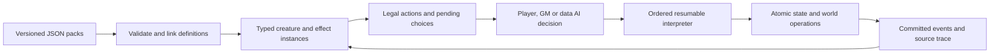

# Data-driven 2024 monster execution plan

> Working design specification. Direction accepted by
> [ADR-0018](../decisions/0018-shared-data-driven-rules-runtime.md), 2026-10-09;
> syntax, complete scope, phase sequence and suggested files remain proposals.
> The [roadmap](../../roadmap.md) chooses one shared runtime proof. Source
> observations/counts below are dated migration inputs, not live certification.

Date: 2026-10-09, America/Chicago. Status: **working specification**. ADR-0018 accepts direction only; this is
not an implemented interpreter, executable schema or full-rules certification.

Build one small, typed rules interpreter shared by creatures, spells and the
features that affect them. Put monster statistics, actions, restrictions,
resource schedules, reactions, transformations and AI policies in versioned
content. Engine code implements interpretation and observable world operations;
it never selects behavior by monster, spell, class or feature identity.

The first proof should be a simple attack followed immediately by a damage
replacement, a suspended reaction and a changing creature state. Converting
hundreds of simple attacks first would hide the architecture's actual risks.

This plan extends the direction of [ADR-0017](../decisions/0017-shared-json-spell-execution.md)
and the [class execution proposal](data-driven-2024-class-execution-plan.md).
Use one interpreter contract for both proposals. Do not implement a competing
monster effect language beside the proposed class language. ADR-0006's named
trusted helpers remain current implementation; ADR-0018 supersedes them as
the target extensibility boundary.

## Evidence, scope and assumptions

The starting inputs are the current JSON, current production source and the
official [SRD 5.2.1](https://media.dndbeyond.com/compendium-images/srd/5.2/SRD_CC_v5.2.1.pdf).
The [official SRD page](https://www.dndbeyond.com/srd) explains that the SRD is a
subset; it excludes creatures such as the Beholder. An SRD-complete engine is
therefore not a verified implementation of every creature in the revised
Monster Manual or every subsequent book.

Interpret "2024 rules" as the revised rules family, including the revised
Monster Manual released in 2025. Pin the exact books, printings and errata in a
corpus manifest. Start with SRD 5.2.1, but preserve the full-catalog target. This
analysis checks representative official mechanics and inventories the local
files; it does not claim a clause-by-clause audit of inaccessible books.

| Assumption | Choice | Adaptation if wrong |
|---|---|---|
| This repository is the intended host. | Godot/GDScript runtime, JSON authoring, Python for inventory only. It already has combat, room, spell and save boundaries. | A standalone C# or TypeScript host can interpret the same contract and fixtures. Choose one authoritative runtime; do not create a second Python combat engine. |
| A human GM can adjudicate fiction. | Procedures can request a typed fact or decision and resume. | Fully autonomous social judgment, illusions and open-ended wishes require additional world models and bounded interpretations. Complete tabletop equivalence cannot be promised. |
| All current creatures matter as migration inputs. | Inventory every winning record and preserve losing source records. | If some are intentional homebrew, place them in an explicitly distinct pack rather than "correcting" them to official rules. |
| Mods are local content packages. | No installed scripting language, remote service or database is required. | Networking adds command ownership and authoritative sequencing; it does not duplicate creature rules. |
| Full fidelity is the destination. | Incremental releases advertise their actual supported clauses. | A bounded adventure can ship sooner, but cannot be described as full creature support. |

### The precise promise

"Nothing hardcoded" literally cannot mean no code with semantics. Arithmetic,
random generation, typed storage, spatial queries, atomic writes and suspension
must exist somewhere. The useful strict promise is:

> Every mechanic in the pinned, verified rules corpus, and every homebrew
> program using those capabilities, is authored as data. New content does not
> require engine branches or native handlers for its identity.

Even a general programming language cannot query an unmodeled plane, distinguish
an untracked item copy or supply sound propagation from a host that lacks it.
An unprecedented observable world capability can require one generic primitive
or adapter. Declare that requirement and fail before costs if unavailable.
That boundary is a missing capability, never "this feature is unusual."

Monster-specific native callbacks would violate this promise. A unique *data
procedure* is allowed; uniqueness does not require an abstraction. JSON programs
are programming expressed as data. That brings a language contract, diagnostics,
versioning and testing obligation. Hiding those obligations behind a large
`effect_type` enum makes maintenance worse.

### What the current data actually contains

The reproducible [inventory](data-driven-2024-monster-inventory.json) records
source locators, hashes, manifest winners, trait descriptions and gaps for all
481 distinct IDs. Regenerate with `python scripts/inventory_monster_design.py`.
This script checks JSON/precedence only; it does not certify runtime behavior.

| Source file | Records | Winning records |
|---|---:|---:|
| `data/core/monsters/core_monsters.json` | 10 | 10 |
| `data/core/monsters/familiar_forms.json` | 4 | 4 |
| `data/core/monsters/imported_monsters.json` | 450 | 235 |
| `data/core/monsters/srd_monsters.json` | 232 | 232 |
| Total | 696 | 481 |

There are 215 IDs with multiple sources, all resolved by the current manifest.
Winning definitions contain 728 attack records, 680 trait records, 160 distinct
trait IDs and 101 attack-effect type strings. Of the traits, 675 have descriptions.
Only four winners explicitly cite `rules_source`; seven explicitly store
`creature_type`, four store senses and two store saving-throw bonuses. None
store `initiative_bonus`. These are raw-field counts: some other facts appear
in prose or loader curation. They are not counts of definitively missing rules.

Existing source inspection establishes four important limits:

- `DataLoader` requires an attack array and an AI behavior string, but that
  shape does not prove every trait or attack effect is executable. It also
  supplies several creature types from `CURATED_MONSTER_TYPES` in code.
- `AIController` selects among native `aggressive`, `defensive` and `support`
  branches; the winning data uses 420 aggressive and 61 defensive records.
- `AICommand` accepts a fixed set of command kinds, attack indexes and a
  bounded slot-based spell path. It cannot directly offer arbitrary data actions.
- The normal monster attack path enters `resolve_weapon_attack`, then a
  limited `resolve_monster_attack_effects` switch only after a hit. That is
  unsuitable for save-only actions, movement actions or independent follow-ups.
  Temporary monster Characters also set proficiency to 2; a full-stat adapter
  cannot use that assumption for every CR.

Do not infer that every effect type is unsupported from one switch: other
production paths exist. The inventory deliberately reports execution as
**not audited**. A later production audit must trace each relevant entry point.

Existing sources are not uniformly faithful transcriptions. For example, the
winning Vampire record puts Bite in an attack-shaped entry, whereas the
[revised Vampire](https://www.dndbeyond.com/monsters/5195251-vampire) resolves it
as a saving throw. The local Troll description omits its limb regrowth on
healing, and the Adult Red Dragon record omits its legendary-action definition.
The manifest still labels its packs `rook-5e-lite-v1`.

Preserve those files as source material. When data and official text disagree,
record the disagreement. The pinned official text governs an official 2024
pack; an intentional variant remains homebrew with its own provenance. Two
contradictory records cannot both be authoritative for the same rules version.

## Architecture progression: propose, attack, salvage

These are counterexample analyses, not reports of prototypes that have run.

| Candidate | Concrete attack | Why it fails | What survives into the next candidate |
|---|---|---|---|
| **A. Stat block plus attacks and passive flags.** | Gelatinous Cube Engulf; Ghost possession. | An attack payload cannot describe travel through occupied spaces, containment, or controlling another body while retaining a distinct identity. | Scalars, explicit statistics, typed damage components and references. |
| **B. Effect arrays with a native handler for each exception.** | Troll Loathsome Limbs; Sphinx Roar. | `spawn_troll_limb` or `resolve_sequential_roar` moves the actual rule into code. A new homebrew exception needs a handler. | Typed operations, validation and source-owned effects; discard named native escape hatches. |
| **C. Pure declarative facts/Datalog to a fixed point.** | Legendary Resistance; Counterspell; a target changed by reflection. | A timeless truth cannot say when a player chooses, when a resource is spent or which earlier outcomes have already committed. Retraction can oscillate. | Pure prerequisite/derived-stat queries with an acyclic dependency graph. No separate Datalog service. |
| **D. Event bus plus unordered modifiers.** | Iron Golem absorption; Shield; damage sharing by a smothering rug. | `on_damage` loses the distinction between being subjected to typed damage, final damage taken and HP loss. Listener registration order must not decide immunity, reflection or absorption. | Events and contributions, augmented by explicit stage contracts and decisions. |
| **E. One data-defined state machine for everything.** | Hydra attack counts interacting with reactions, damage and control; overlapping conditions. | A global cross-product of states grows combinatorially. An independent bonus should not require a new global state. | Local machines for roar sequence, possession, curses and escape/recovery. |
| **F. General Lua/JavaScript or native mod scripts.** | A mod directly changing HP during a pending reaction or calling external APIs. | Expressive, but bypasses ordering, ownership, persistence and generic explanations. It shifts the requirement from interpreted data to arbitrary executable extensions. | Small typed programs and local variables. Discard arbitrary host access and native callbacks. |
| **G. Ordered typed programs + queries + contributions + local machines.** | Brass Dragon Shapechange override; familiar restrictions altered by Pact of the Chain; pending damage followed by a spawn. | Works only if procedures expose modifiable parameters, relationships are explicit and continuations are first-class. Without those, it collapses back to B or D. | Adopt with the contracts and early failure tests below. |

The unusually useful discriminator is the
[Adult Brass Dragon](https://www.dndbeyond.com/monsters/5194871-adult-brass-dragon):
its Shapechange invocation restricts forms and changes Temporary HP and
Concentration requirements. Copying a spell's usual payload cannot express
that. A call must be able to supply typed overrides to published rule parameters.

The class boundary is also a real attack on the model: Pact of the Chain allows
an owner attack to be exchanged for a familiar attack using the familiar's
Reaction. The familiar's ordinary restriction cannot simply delete its attack
definition. Both the prohibition and its qualified permission must be data.
This requires a parent action identity, delegated authorization and costs
belonging to different actors. [SRD 5.2.1, Warlock](https://media.dndbeyond.com/compendium-images/srd/5.2/SRD_CC_v5.2.1.pdf#page=74).

## Chosen model

### Separate definitions, instances and world facts

| Record | Required contents | Owner |
|---|---|---|
| Content pack | Namespace, version, rules source/errata, dependencies, required capabilities, explicit overrides. | Loader. |
| Creature definition | Statistics, movement/senses/languages, action/feature references, initial typed state, form/factory references, default decision policy. | Immutable content. |
| Procedure definition | Typed inputs/results, ordered named steps, public parameters/stages, legal writes, cost and interruption contracts. | Immutable content. |
| Feature/effect definition | Prerequisites, derived contributions, stage subscriptions, lifetime/stacking definitions, granted actions, local state/machines. | Immutable content. |
| Actor instance | Stable identity, definition/version, current HP, resource balances, effect/state instances, position/presence, selected parameters, relationships, controller. | Campaign state, projected into encounters. |
| Relationship instance | Typed endpoints, source, capacity, control/position/stat policies and independently defined lifetime. | Campaign state. |
| Workflow instance | Root command, step cursor, locals/results, event stack, pending decision, recorded dice, reservations and committed step keys. | Authoritative runtime. |
| World facts | Objects and item-copy identities, bodies, geometry, planes, lighting, water, clocks, observed facts and GM decisions. | Host adapters plus declared facts. |

Creature type, damage/condition categories, action categories and custom state
types use namespaced declarations with a data-defined schema. Core vocabulary
has published semantics. A mod may declare another category/state field and
use it in rules; it must not expect the host to render a wholly new physical
phenomenon merely because the category exists.

Use canonical feet and seconds, with explicit modes, reach, normal/long range,
area shape and altitude. The current five-foot hex grid is an adapter. Never
encode "6" without saying whether it means feet, hexes, rounds or uses.
Keep HP average and dice expression, scores, modifiers, save bonuses, attack
bonuses, DCs and initiative independent when the printed stat block specifies
them. Do not reconstruct every published bonus from ability and CR.

### Small interpreter vocabulary

JSON stores an abstract syntax tree: a structured program rather than an
expression string passed to `eval`. These are proposed contracts, not enabled
opcodes in the current project.

| Instruction family | Semantics |
|---|---|
| `bind`, `branch`, `foreach`, `repeat` | Typed locals, conditional flow, deterministic iteration of a captured collection, nonnegative finite repetition. |
| `query`, `choose`, `adjudicate` | Pure queries; resumable decisions from legal options; recorded GM facts with declared input/output types. |
| `roll`, `invoke`, `stage` | Recorded random values; call a data procedure; publish a typed decision/modification window. |
| `reserve`, `spend`, `release` | Qualified resource/token payment at declared boundaries; no silent refund policy. |
| `contribute`, `replace`, `grant`, `remove` | Contributions to published ports; scoped proposals; source-owned effects/actions; qualified cleanup. |
| `update`, `transition`, `mark`, `schedule` | Validated writes to declared state, local machine transitions, usage identities and exact deadlines. |
| `spawn`, `bind_relation`, `project`, `move`, `despawn` | Generic entity creation, relationships, reversible field projection, world movement and removal. |

Expressions use literal JSON values, `{"ref":"locals.target"}` for typed
references, and `{"calc":"add","args":[...]}` for pure arithmetic or Boolean
operations. Collections, enum membership, min/max, floor, set operations and
recorded-event accumulators are available. Typed query definitions may invoke
pure world capabilities such as distance, visibility or legal placement.

Dice use structured `{count, sides, bonus}` records, whose values can be
expressions. No code in strings. The import tool may parse legacy dice strings
into this representation, preserving complete flat bonuses.

Procedure calls have stable named steps/results. Each check and target has
its own result, and a later step refers explicitly to it. There is no universal
`attack.hit` or cast-wide `saved` Boolean for a composite action.

Direct procedure calls and derived-query dependencies must be acyclic in the
initial language. Finite loops and later scheduled events cover the demonstrated
workflows without unbounded recursion. Event cycles are checked separately.
If a real corpus mechanic requires a different control construct, add that
generic construct rather than a creature handler.

Native instruction dispatch may switch on `choose`, `update` or `spawn`.
Dispatch on `troll`, `engulf`, `pact_of_the_chain` or `vampire_bite` is forbidden.
Names such as `core:engulf` are perfectly valid **data procedures** composed
from the instructions above. No procedure can call a feature-specific native
resolver through a string field.

### Rules are data too

The ruleset pack defines D20 tests, action budgets, damage ordering, conditions,
rest benefits, death/zero-HP processing, spell casting and standard movement
policies. The host supplies raw dice, storage and spatial capabilities. A native
damage adapter must not independently apply a monster immunity or class rider
after the interpreted damage procedure has already handled it.

Reuse production math/geometry where it is behavior-neutral. Where a current
resolver mixes generic calculation and named exceptions, expose a narrow raw
operation beneath those exceptions. Keep the old callers working during
migration. Invoking the entire existing resolver and adding data listeners on
top risks applying the same rule twice.

This is a larger commitment than adding a monster schema. It is justified by
the user's stated purpose: content authors must control interactions too. A
perfectly generic monster loader attached to hardcoded class/spell behavior
would still fail that purpose.

### Feature modification and conflict rules

A procedure publishes semantic ports: for example `shapechange.allowed_forms`,
`shapechange.hp_policy`, `cast.components`, `cast.concentration`,
`multiattack.unit_options`, `test.outcome` and `damage.components`.
Each port declares types, combination policy, stage and permitted writers.
These declarations are data, so a mod can publish new procedures and ports.

A contribution names the definition, port version, applicability predicate
and value/program. It never patches a JSON array index or an arbitrary host
field. Actor capabilities and source-instance relationships qualify effects;
display names do not.

Combination operators include sum, union, intersection, maximum, minimum,
choose-one and replace. Ruleset data selects them. Advantage cancellation,
identical-effect stacking and AC alternatives are different policies.
Preserve each source even when only one source currently contributes a value.

"Specific beats general" requires an explicit override relationship. Different
pack priorities cannot resolve an in-play rules conflict. Conflicting replacements
must have a declared precedence/decision or cause a diagnostic. Simultaneous
choices follow the pinned ruleset's decision-owner policy; alphabetical IDs
may order a menu, but may not settle the outcome.

### Choices and resource ownership

Choices declare their decision owner, legal options, timing, min/max count,
dependencies and persistence. An early choice can define later options: summon
type, damage type, body/form, target set or attack substitution. Store the
chosen value, not a UI index. Revalidate at each commitment after reactions.

Resources are not all integers named `uses`. Support qualified token pools,
capacities, finite uses, scoped locks and a readiness state. Their refresh
programs subscribe to explicit events: actor turn start, any current turn,
completed Short/Long Rest, sunrise/sunset, elapsed time or another event.
The pinned monster rules define **X/Day recovery on a completed Long Rest**.
**Recharge X–Y** uses a d6 at the monster's turn start and also recovers on a
completed Short or Long Rest. Those policies belong in data, with successful
faces and recovery events declared explicitly; a rest-only recharge uses only
its specified rest events. Do not substitute midnight, dawn or a new encounter.
[Running monsters: Limited Usage](https://www.dndbeyond.com/sources/dnd/br-2024/how-to-use-a-monster#LimitedUsage).

Recharge is a resource program: while unavailable, evaluate the turn-start roll
at the specified boundary, branch on its successful faces and set ready.
Legendary-action uses and Legendary Resistance uses are separate pools; an
action-specific lock is separate again. The off-turn decision window also
enforces the ruleset's one-legendary-action-per-window restriction and its
Incapacitated/action eligibility rule.

"Once per turn" keys the actual current turn ID; "until your next turn" refers
to the subject actor's next boundary. A per-target immunity uses source-instance
ID + target ID + expiry, so success against one Ghost does not grant immunity
to every Ghost. Restoring a save rebuilds balances without emitting recovery.

Hydra extra reactions require tokens restricted to Opportunity Attacks, not
an unrestricted `reaction_count`. Dynamic capacity must preserve spent tokens;
recomputing a capacity after an effect changes must not accidentally refill it.

### Identity, relationships and transformations

An actor has a stable logical identity, physical presence/body, effective stat
view and controller. These usually coincide; possession proves that they must
be distinguishable. Action ownership, position origin, HP recipient and targetable
entity can therefore differ under explicit relationship policies.

Use source-owned relationships for grapple, containment, charm, creator,
controller, rider/mount and attached body. A generic condition is not enough
to identify whose hand grapples whom, which capacity is occupied, who can
rescue the target, or what follows movement. Effects can grant escape/rescue
actions to the victim or nearby helpers through the normal action catalog.

A transformation is a reversible projection with explicit retained/replaced
fields, HP/temp-HP policy, available-action changes, equipment behavior and
termination conditions. Preserve the underlying actor and item-copy identities.
Removing a projection reveals the *current* underlying state; it must not
restore a stale snapshot over damage or independent effects acquired meanwhile.

Appearance change, speed-only projection, stat-block replacement and possession
are different data policies using the same capabilities. Do not copy the
Polymorph policy into Imp Shape-Shift or a familiar factory.

Factories accept captured casting parameters and explicit live bindings. Store
spell level at creation when appropriate; separately specify whether a summon
queries its owner's current spell attack modifier or uses a captured value.
The source decides. Never silently snapshot every owner statistic or silently
make every statistic live.

Existence, presence, obedience and control each have their own lifetime. Animate
Dead control expiry must not despawn its lasting creature. Treant animation,
familiar pocket presence and vampire mist recovery use different policies.
Initiative is a data relationship: independent roll, same count after another
actor, or another published schedule. The scheduler implements that relationship
without checking the creature's name.

### AI is another content consumer

Generate the legal action/choice catalog from the same procedures used by manual
control. A data policy selects among those options, with guards, scores,
priorities, weights, tie rules, path preferences and local memory. A local
state machine can change its goals. Generic search/pathfinding executes those
instructions; the content declares preferences.

The policy sees only facts available to that actor unless the content explicitly
allows omniscience. Charm target prohibitions are legality contributions, not
special exclusions remembered only by AI. Berserk is an effect that changes
the actor's policy/choices. A player taking control must receive the same
restrictions.

Monster tactics are generally a GM choice rather than one mandatory stat-block
algorithm. Separate an official mechanical rule from an authored tactical
preference. Manual control is always a valid decision provider. A generic fallback
policy itself lives in data, including any flee thresholds; engine code must
not impose a universal "nearest player" target rule.

The source's running-monster guidance does prioritize powerful limited-use
abilities, Multiattack and frequent use of off-turn options. Encode that as a
default policy in the rules pack, with manual override, rather than claim that
the rulebook supplies no guidance. Lowest-level monster spell permissions and
long casting-time rules must also be explicit: listing a spell does not make
every casting instantaneous or permit arbitrary upcasting.
[Monster action and casting rules](https://www.dndbeyond.com/sources/dnd/br-2024/how-to-use-a-monster).

## How execution works



1. Load packs in declared dependency order. Validate structure, references,
   types, procedure/port contracts, capabilities and conflicts. Build an immutable
   registry and stage-subscription indexes. Reject unknown instructions and
   unsupported enabled content before starting a session.
2. Instantiate a creature once with a stable ID, declared initial state and
   captured parameters. Register its sourced features and relationships.
   Encounter entry projects existing actors instead of healing/recreating them.
3. Query legal actions and decision options. Human and AI commands reference an
   action instance, actor, parameters and targets. Costs come from definitions,
   never from a HUD-supplied amount or attack index alone.
4. Validate, reserve where appropriate, then execute named steps. At each public
   stage gather eligible contributions and optional reactions. Pause for decisions;
   a reaction runs as a child workflow. Refresh parent legality/outcome afterward.
5. Commit each outcome and its costs/usage marks exactly once. Emit completed
   events only after atomic writes. Continue independent later steps even when
   earlier checks miss if the program explicitly requires it.
6. Persist canonical actor/effect/relationship state and pending continuations.
   Rebuild derived views on load without firing activation, acquisition or rest
   events. Render the same source trace into a concise combat explanation.

### Stage contracts must be explicit

| Workflow | Required distinctions |
|---|---|
| D20 test | Context, before roll, dice result, provisional outcome, outcome-changing decisions, final result. |
| Attack | Declaration/targeting, test, provisional hit, defenses, final hit, damage, independently gated follow-ups. |
| Damage | Incoming typed components, save transformations, applicable modifiers, mitigation, replacement/absorption, final damage taken, temp-HP/HP changes, zero-HP/death proposal, completed events. |
| Spell | Invocation source and effective parameters, component/target checks, declaration costs, interruption, payload steps, conditional payment/refund, completion. |
| Movement | Mode/path validation, departure/entry per traveled segment, containment/attachment updates, arrival; teleport does not manufacture traveled distance. |
| Time/lifecycle | Current turn boundaries, actor-relative boundaries, rests, calendar events, state/equipment changes, defeat/removal and encounter transitions. |

These are required semantic distinctions, not a claim that one immutable
universal damage order fits every rule. The ruleset supplies the workflow and
exception ports; early source fixtures determine exact ordering. Effects cannot
arbitrarily write an already-finalized result. A rule needing replacement must
bind before its relevant commitment, or explicitly create a later effect.

Damage results retain per-type and per-source totals at each applicable stage,
plus HP/temp-HP loss. "Damage taken" is not automatically interchangeable with
"HP lost". A rule such as lifesteal must select the exact measure named in its
source. Record the selected interpretation when the rules are ambiguous.

Events retain source, actor, caster, target, body, parent/root IDs, procedure and
step ID, stage, current turn ID, magical/spell/attack properties and finalized
results. Spell-invoked weapon attacks, innate spell attacks and non-spell magical
effects cannot be reduced to a single `is_spell` flag.

### Commit, cancellation and loops

Use small atomic commitments, not rollback of a whole turn. After damage commits,
canceling a later movement choice cannot undo it. Before commitment, invalid
placement or canceled target selection spends nothing. A countered cast follows
its data-defined action and resource policy; do not infer refund rules from the
final balance of a pool.

A continuation stores the definition versions, cursor, locals, recorded RNG,
pending choice, reservations and committed step/target keys. Reloading or
receiving the same decision twice cannot reroll known dice, spend again, emit a
duplicate death event or spawn a second limb.

Detect derived-query cycles and direct call cycles at load. Event causality can
still create loops. Every subscription declares repeat scope and eligibility
against parent causes. Execution budgets suspend with an explanation and a
recoverable continuation; they must never quietly omit legal effects. Test
damage reflection and mutual damage-sharing loops. Do not suppress all child
events: that would also suppress valid triggered spells and reactions.

## Representative mappings and adversarial checks

The summaries below are selected discriminators, not complete stat-block
transcriptions. Proposed implementations must add every remaining source clause
to the ledger before certifying the whole creature. Each cited block supports
the mechanic; the representation and tests are engineering proposals.

| Creature / interaction | Rule discriminator | Data representation | First failure test |
|---|---|---|---|
| Cat / ordinary weapon attack | Local familiar-form data has explicit attack bonus and flat damage. | Explicit statistic plus attack procedure; target kind, reach and damage are data. | Same action through AI/manual control; do not add an ability modifier to already complete damage. |
| Zombie / Undead Fortitude | Zero-HP behavior already exists through the created-creature path. | Before-death replacement procedure using event damage, critical/type facts and a save. | Naturally encountered and created Zombie share behavior; prevent premature initiative removal. Reconcile core versus created stat differences first. |
| Adult Red Dragon | Recharge, attack substitution and off-turn action resources. | Composite action, qualified spell invocation, independent pools and per-option locks. | Replacement consumes one attack unit; rays do not each spend another Action; off-turn use never consumes Reaction. |
| Adult Brass Dragon | A monster changes a shared spell's parameters. | Contribution to published Shapechange ports scoped to this invocation. | Ordinary Shapechange unchanged; modified creature retains its intended form/HP/concentration policy. |
| Iron Golem | Fire absorption coexists with Fire immunity. | Replacement at a typed damage stage before immunity erases the amount needed for healing. | Fire heals once, mixed damage settles independently, and zero-fire results do not trigger ordinary took-damage listeners. |
| Hydra | Mutable heads drive attack count and restricted reactions. | Typed state, current-turn accumulators, actor-relative windows, computed action units and qualified reaction tokens. | Damage spread over separate turns differs from a threshold crossed in one turn; head regrowth must not refill spent reactions accidentally. |
| Troll + Troll Limb | A trait spawns an actor, then healing changes another trait's state. | End-of-any-turn trigger, damage accumulator, spawn factory, initiative relationship, source-owned Exhaustion contribution. | Save/load after threshold and before trigger; one limb spawned, no duplicate use; regrowth removes only the missing-limb contribution. |
| Gelatinous Cube | Travel, capacity, containment and a failed successful-save exit. | Movement procedure plus typed containment relation, actor-granted escape and helper-granted rescue actions. | Successful save with no legal exit becomes failure before damage is committed. Entering voluntarily and cube moving into someone use the right contexts. |
| Ghost | Possession changes body control and stat provenance. | Two actor identities, possession relation, selective projection and special targeting permission. | Damage to host vs targeted Undead spirit remains distinct; expulsion restores host control and creates source-specific immunity. |
| Vampire | Save-only Bite, form permissions, linked charm changes and escape lifecycle. | Ordered action, typed component results, scoped Charm Person overrides, form projection and local recovery machine. | Bite requires the declared eligible target; last HP does not automatically mean destruction; missing sunlight/water facts cause a clear decision. |
| Rakshasa | Automatic spell outcomes, conditional vulnerability and information blocking. | Outcome replacement, source-qualified damage predicate, permission-gated sensing query. | Bless on the attacking actor qualifies damage; a generic magical damage source is not automatically a spell attack. |
| Treant / Animate Trees | Stat-block reuse must omit its own creator action. | Factory with explicit field/action projection and initiative/existence relationships. | Animated child cannot recursively animate more trees; expiry does not delete the original tree object. |
| Draconic Spirit / Summon Dragon | Casting choices and spell level create derived creature stats and linked owner effects. | Parameterized factory, typed choices, declared live/captured bindings and source-owned owner resistance. | Two spirits from separate sources do not remove each other's grants; replacement/expiry cleans up the correct source. |
| Familiar + Pact of the Chain | One creature's restrictions are changed by its owner's feature. | Restricted attack permission plus delegated child invocation and payment from owner attack unit/familiar Reaction. | Familiar ordinary turn remains restricted; delegated attack allowed once with legal Reaction; no removal of its attack definition. |
| Sphinx of Valor | Prior uses select subsequent effects. | Local roar state machine, use pool and repeat-save effects. | Reload between roars preserves next effect; failed target saves do not rewind the sequence. |
| Animated Rug of Smothering | A relationship modifies damage to two actors. | Linked damage replacement/transfer procedure tied to an active grapple instance. | Mitigation and rounding occur at the verified stages; death/removal ends the right relation and does not recursively share forever. |
| Tarrasque | Reflection changes a pending spell's target; swallowing has its own exit rules. | Target replacement plus typed spell predicates; capacity-based containment, per-turn internal damage accumulator. | Multiple spell steps preserve separate results/costs; reflection does not recast or spend again; corpse escape remains available. |

### Source discriminators that must not be lost

**Dragon action budgets.** The revised
[Adult Red Dragon](https://www.dndbeyond.com/monsters/5194875-adult-red-dragon)
has three legendary-action uses, four in its lair, refreshed at its own turn
start. Some options separately lock until that boundary. Its Multiattack can
exchange one Rend for Scorching Ray. This needs both a pool and per-option locks,
not a single generic once-per-round counter. In-lair variants must define when
capacity is sampled; entering a lair must not automatically refill resources.

**Absorption.** [Iron Golem](https://www.dndbeyond.com/monsters/5195090-iron-golem)
heals when subjected to Fire damage despite having Fire immunity. Preserve
the eligible incoming Fire amount in a replacement proposal, cancel its damage
settlement, and invoke healing once. A listener observing only final HP loss
cannot implement this. The exact handling of other simultaneous modifiers is
a source fixture, not an assumption copied from a legacy damage pipeline.

**Hydra histories.** [Hydra](https://www.dndbeyond.com/monsters/5195084-hydra)
head loss depends on damage during one turn; regrowth refers to heads lost
and Fire damage since its previous turn. Extra reactions are limited to
Opportunity Attacks. Use separate current-turn and owner-interval histories.
Its printed initiative also cannot be inferred solely from Dexterity.

**Troll sequencing.** [Troll](https://www.dndbeyond.com/monsters/5195241-troll)
checks its limb-severing condition at the end of any turn, has four daily uses,
and creates a Troll Limb. Missing limbs contribute Exhaustion; healing regrows
them. Acid/Fire suppresses the next regeneration opportunity. Source state and
death proposals must remain intact until the required boundary. The relation
to instant-kill effects deserves an explicitly recorded interpretation if the
pinned corpus does not settle the interaction.

**Cube containment.** [Gelatinous Cube](https://www.dndbeyond.com/monsters/5195005-gelatinous-cube)
checks capacity, moves engulfed targets, provides cover, restricts Verbal
spellcasting and enables escape/rescue. A successful save without a legal exit
instead fails. Store an unresolved save outcome until exit placement is known;
half-damage commitment before placement would be wrong. The capacity rule is
its own predicate, not an assumed universal creature-volume formula.

**Ghost control.** [Ghost](https://www.dndbeyond.com/monsters/5195008-ghost)
keeps its statistics during possession except specified host-derived Speed
and physical modifiers. It remains separately reachable by effects explicitly
targeting Undead. The host retains awareness and later regains control.
Ghost/host controller and HP routing therefore need explicit policies. Its
24-hour immunity is tied to that Ghost, not a blanket possessed Boolean.

**Vampire lifecycle.** [Vampire](https://www.dndbeyond.com/monsters/5195251-vampire)
Bite uses a Constitution save and qualified targets; typed Necrotic damage
drives healing and maximum-HP reduction. Its Charm invocation changes duration
and the Bite interaction. Misty Escape is an automatic form/lifecycle transition,
not an ordinary Bonus Action. Burial and sunset can create a controlled spawn.
Do not import a legacy regeneration feature or universal Long Rest cure for
maximum-HP reduction without a source clause.

**Information is also a rule.** [Rakshasa](https://www.dndbeyond.com/monsters/5195178-rakshasa)
automatically succeeds on specified magical saves, avoids spell attacks, and
blocks certain information spells without permission. Its Piercing vulnerability
depends on a weapon's wielder being under Bless. The data predicate may
explicitly refer to another data definition; that is allowed. Generic `magical`
or `blessed weapon` tags must not erase the actual source qualification.

**Factory projection.** [Treant](https://www.dndbeyond.com/monsters/5195236-treant)
animation reuses its block with specified mental scores and no Animate Trees.
The trees act after it and have distance/death/time termination conditions.
Keep original tree identity and a reversible animation projection; an ordinary
clone of the parent's full feature set would create recursive summoning.

**Summon parameters.** [Summon Dragon](https://www.dndbeyond.com/spells/2618843-summon-dragon)
defines spell-level-dependent AC, HP and attack count, owner-linked attack/DC
values, a Breath damage choice and a separately chosen shared Resistance.
Represent those as different choices/bindings. Do not require them to use the
same selection merely because both involve a damage type.

**Ordered uses.** [Sphinx of Valor](https://www.dndbeyond.com/monsters/5195213-sphinx-of-valor)
has a sequence of three different Roars reset by a Long Rest. Sequence position
and remaining uses are distinct state. Its Multiattack includes Roar, so
availability of that child must follow the adopted exhausted-resource rule;
never treat the sequence as three interchangeable AI attacks.

**Linked damage and reflection.**
[Animated Rug of Smothering](https://www.dndbeyond.com/monsters/5194896-animated-rug-of-smothering)
changes damage while grappling its victim.
[Tarrasque](https://www.dndbeyond.com/monsters/5195232-tarrasque)
can make certain spells ineffective or reflect them to the caster. These require
distinct child damage/target proposals with causal parent IDs. Test multi-target
and multi-step spells; do not pretend one cast-wide target swap is universally
correct. Ambiguous reflection granularity must be documented and adjudicated,
not settled by listener order.

## Proposed authoring examples

The following fragments are **design notation**. They are valid JSON examples,
not content accepted by today's loader. `core:*` names refer to data definitions;
their bodies are to be authored using the interpreter vocabulary above.

### Creature definition and runtime instance

This envelope carries selected values from the local Cat definition. It is
disabled pending full source reconciliation and missing definition references;
it demonstrates the record boundary, not a complete certified Cat. In final
content, every referenced action/feature/policy must link successfully. An
intentional homebrew creature can declare its own values and custom state using
exactly this contract.

```json
{
  "id": "example:cat_from_local_data",
  "kind": "creature",
  "format_version": 1,
  "enabled": false,
  "source": {
    "locator": "res://data/core/monsters/familiar_forms.json#1",
    "claimed_rules_source": "SRD 5.2.1",
    "reconciliation": "pending"
  },
  "name": "Cat",
  "stats": {
    "size": "core:tiny",
    "creature_type": "core:beast",
    "armor_class": 12,
    "hp": {"dice": {"count": 1, "sides": 4, "bonus": 0}, "creation_policy": "roll_once"},
    "ability_scores": {"STR": 3, "DEX": 15, "CON": 10, "INT": 3, "WIS": 12, "CHA": 7},
    "proficiency_bonus": 2,
    "movement_feet": {"walk": 40, "climb": 40},
    "senses_feet": {"darkvision": 60},
    "skill_bonuses": {"Perception": 3, "Stealth": 4},
    "save_bonuses": {"DEX": 4}
  },
  "actions": ["srd2024:cat/scratch"],
  "features": ["srd2024:cat/jumper"],
  "decision_policy": "example:guard_corridor",
  "initial_state": {}
}
```

The instance created from an enabled definition holds `entity_id`, definition
version, current/max HP, position, controller, state/resource/effect instances
and relationship IDs. It references immutable action definitions instead of
duplicating their programs. A familiar source grants a separate relationship
and attack prohibition to that instance; the underlying Cat definition remains
usable as an ordinary creature.

### A simple explicit attack

This maps the local Cat Scratch entry without inferring bonuses or interpreting
prose. The creature definition references this action; the actor owns its
action budget, and the shared procedure owns check/damage timing.

```json
{
  "id": "srd2024:cat/scratch",
  "kind": "action",
  "costs": [{"pool": "actor.actions", "amount": 1, "at": "declare"}],
  "inputs": {"target": "entity_ref"},
  "body": [
    {
      "step": "scratch",
      "op": "invoke",
      "procedure": "core:attack",
      "args": {
        "actor": {"ref": "actor.id"},
        "target": {"ref": "inputs.target"},
        "delivery": "melee",
        "reach_feet": 5,
        "attack_bonus": 4,
        "damage": [{"type": "core:slashing", "amount": 1}]
      }
    }
  ]
}
```

### A feature creating another actor

This is the core of Troll limb creation, with damage accumulation and Exhaustion
contribution defined separately. `current_turn` denotes whoever is acting, not
just the Troll's own turn. The quoted threshold is a recorded query, not an
engine function called `troll_limb_check`.

```json
{
  "id": "srd2024:troll/loathsome_limbs",
  "kind": "feature",
  "state": {"missing_limbs": {"type": "integer", "initial": 0}},
  "resource": {"id": "limb_uses", "capacity": 4, "recovery": "core:monster_daily_uses"},
  "subscriptions": [{
    "stage": "core:turn/end",
    "when": {"calc": "and", "args": [
      {"query": "core:is_bloodied", "args": {"entity": {"ref": "actor.id"}}},
      {"calc": "gte", "args": [
        {"query": "core:damage_taken_in_turn", "args": {
          "entity": {"ref": "actor.id"},
          "turn": {"ref": "event.turn_id"},
          "damage_type": "core:slashing"
        }},
        15
      ]},
      {"query": "core:resource_available", "args": {"resource": "self.limb_uses", "amount": 1}}
    ]},
    "body": [{
      "step": "sever",
      "op": "invoke",
      "procedure": "core:atomic_changes",
      "args": {"changes": [
        {"op": "spend", "resource": "self.limb_uses", "amount": 1},
        {"op": "update", "field": "self.state.missing_limbs", "mode": "add", "value": 1},
        {"op": "spawn", "definition": "srd2024:troll_limb", "position": {"ref": "actor.position"},
          "initiative_relation": {"mode": "after_actor", "actor": {"ref": "actor.id"}}}
      ]}
    }]
  }]
}
```

`core:atomic_changes` is a data procedure over the runtime's buffered commit
instruction. The host validates the whole write set before spending or spawning.
Limb placement uses the rule's permission to share that source space. Do not
silently substitute generic unoccupied-cell placement or spend the use when
the required world representation cannot be created.

The other trait contributes Exhaustion equal to `missing_limbs`, observes actual
healing and sets the field to zero. A source-owned contribution allows that
removal without removing Exhaustion from another cause. The fate of already
independent limb actors follows their own source definition, not an invented
"delete children on heal" rule.

### A composite action with one replacement

Attack units belong to this action instance. A spell replacement consumes one
unit, even if its own procedure creates multiple attacks. The substitution
permission authorizes inherited Action payment only; it does not bypass
components, targeting, interruption or a spell's other resource requirements.

```json
{
  "id": "srd2024:adult_red_dragon/multiattack",
  "kind": "action",
  "action_category": "core:attack",
  "costs": [{"pool": "actor.actions", "amount": 1, "at": "declare"}],
  "body": [{
    "step": "attacks",
    "op": "invoke",
    "procedure": "core:action_sequence",
    "args": {
      "units": 3,
      "normal_option": "srd2024:adult_red_dragon/rend",
      "substitutions": [{
        "id": "fiery_spell",
        "max_per_sequence": 1,
        "invoke": "core:cast",
        "args": {
          "spell": "srd2024:scorching_ray",
          "permission_source": "srd2024:adult_red_dragon/spellcasting",
          "action_payment": "inherited_unit"
        }
      }]
    }
  }]
}
```

`core:action_sequence` defines exactly when options/targets are chosen and whether
movement is permitted between steps under the pinned rules. Do not force all
attack targets to be fixed before the first attack. Under the pinned 2024
monster rules, Multiattack describes attacks and additional abilities taken
as part of the Attack action; retain that parent action category even when a
child invokes Spellcasting. Do not import the older blanket assumption that
Multiattack is unrelated to the Attack action.
[Multiattack rules](https://www.dndbeyond.com/sources/dnd/br-2024/how-to-use-a-monster#Multiattack).

### A spell invocation changing a shared feature

```json
{
  "id": "srd2024:adult_brass_dragon/shapechange_permission",
  "kind": "casting_permission",
  "spell": "srd2024:shapechange",
  "payment": {"mode": "at_will"},
  "overrides": [
    {"port": "core:cast/components.material@1", "value": false},
    {"port": "core:shapechange/allowed_types@1", "value": ["core:beast", "core:humanoid"]},
    {"port": "core:shapechange/grant_temporary_hp@1", "value": false},
    {"port": "core:shapechange/require_temporary_hp_to_maintain@1", "value": false},
    {"port": "core:cast/require_concentration@1", "value": false}
  ]
}
```

Ordinary casting uses the same definition without this permission's scoped
overrides. If a required port is not supported, loading rejects this enabled
record. A macro named `dragon_shapechange` may generate these data contributions;
it may not invoke a native handler by that name.

### A parameterized creature factory

This illustrates selected Draconic Spirit dependencies. The complete factory
must also define all statistics, its two distinct choices, initiative/control,
concentration lifetime and source cleanup.

```json
{
    "id": "srd2024:draconic_spirit/factory",
  "kind": "factory",
  "inputs": {"owner": "entity_ref", "spell_level": "integer", "breath_type": "damage_type_ref"},
  "captured": ["spell_level", "breath_type"],
  "stat_expressions": {
    "armor_class": {"calc": "add", "args": [14, {"ref": "inputs.spell_level"}]},
    "max_hp": {"calc": "add", "args": [50, {"calc": "multiply", "args": [10,
      {"calc": "subtract", "args": [{"ref": "inputs.spell_level"}, 5]}]}]},
    "rend_count": {"calc": "floor", "args": [{"calc": "divide", "args": [{"ref": "inputs.spell_level"}, 2]}]}
  },
  "binding_contracts": {
    "rend_attack_bonus": {"source": "owner.spell_attack_modifier", "sampling": "source_review_required"},
    "breath_save_dc": {"source": "owner.spell_save_dc", "sampling": "source_review_required"}
  },
  "actions": ["srd2024:draconic_spirit/multiattack"],
  "existence": {"until": "source_spell_ends"}
}
```

The `source_review_required` markers deliberately prevent this incomplete
factory from becoming enabled content. The final authoring schema must require
an actual binding policy. This example identifies a critical semantic choice
rather than quietly choosing snapshot or live behavior for every summon.

### Attack the chosen architecture before freezing it

The hybrid model is still vulnerable to bad contracts. Resolve these questions
in the first source ledger and prototypes, with recorded interpretations where
the pinned text is insufficient:

| Attack on the final model | Required response |
|---|---|
| Hydra damage crosses the threshold repeatedly in one turn. | Define the source-reviewed repeat policy; do not infer `floor(damage / 25)` or a repeat count from the threshold alone. |
| A form or possession changes statistics while a pending check is suspended. | Every step declares when values are sampled. Revalidate live values where required; retain already recorded dice and committed outcomes. |
| Counterspell interrupts a cast paid through an innate daily-use permission. | Define the payment lifecycle for that permission separately from spell-slot refunds. One generic refund-all rule is insufficient. |
| Reflection affects only one part of a spell with multiple rays or targets. | Preserve invocation, step and target scopes; record the source interpretation of reflection granularity. Do not substitute a full recast. |
| Three effects offer mutually incompatible outcome replacements. | Published ports need a conflict/decision policy; priorities chosen by the engine do not establish rules fidelity. |
| A mod introduces flight on a host whose map has no altitude/landing model. | A label is insufficient. Declare and verify a generic world capability, or reject the enabled mechanic honestly. |

Passing these attacks establishes a usable contract for those cases. It is not
a proof that the unseen full catalog fits; corpus closure remains the final gate.

### A data AI policy

This is homebrew tactical preference, not an official monster rule. Every
candidate still passes the shared legal-action query.

```json
{
  "id": "example:guard_corridor",
  "kind": "decision_policy",
  "rules": [
    {"priority": 30, "when": {"query": "example:retreat_needed"},
      "choose": {"query": "example:legal_retreat_commands"}},
    {"priority": 20, "when": {"query": "example:profitable_area_available"},
      "choose": {"query": "example:legal_area_commands"}},
    {"priority": 10, "choose": {"query": "example:legal_guard_commands"}}
  ],
  "ties": {"mode": "seeded_weighted_choice"},
  "fallback": "core:dodge_if_legal"
}
```

Policies can name a creature-specific data action, but the policy evaluator
must not recognize that creature's ID. Choice providers use the same workflow
continuations for AI, player and GM decisions.

## Import and source reconciliation

Create a corpus/clause ledger before claiming complete coverage. Its unit is a
rule clause, not a monster name or trait ID. Every field/action/trait clause
needs a source version/location, local source locator, canonical definition,
dependencies, interpretation record and production fixture result.

Suggested statuses: `source_needed`, `reconciled`, `representable`,
`implemented`, `verified`, and `adjudication_required`. These are separate
dimensions where useful: a mechanically verified interpreted rule can still
need a GM's fictional fact. Current inventory `not_reviewed` and `not_audited`
must never be automatically upgraded from a successful import.

| Current field | Mapping | Required caution |
|---|---|---|
| `id`, `name`, `description` | Namespaced ID, display metadata, source provenance. | Display text never executes. Preserve campaign IDs through explicit aliases, not approximate name matching. |
| `hit_points` | Dice AST and explicit average/stat policy. | Dice alone do not recover missing printed HP or the intended spawn policy. |
| `armor_class`, `ability_scores` | Explicit base statistics. | Do not invent missing save/initiative/skill bonuses from scores. |
| `speed`, attack `range` | Canonical feet plus movement/reach/range modes. | Current integers commonly encode hexes; normal/long range cannot be recovered from a single number. Mixed feet/hex fields need provenance. |
| `attacks` | Action procedures with delivery/check/target semantics. | Some entries are saves, areas or movement. Vampire Bite and Cube Engulf demonstrate that an attack-shaped object is not evidence of an attack roll. |
| `extra_effects` | Ordered checks, typed effects, follow-ups and lifetimes. | Most source enum names compress several rules; decompose from source rather than generate one native opcode per enum. |
| `special_abilities` | Features, actions, subscriptions, machines and factories. | Prose conversion needs review. Omitted conditions, escape rules and durations cannot be recovered reliably by a regex. |
| defenses | Qualified contributions to damage/condition workflows. | `piercing_from_blessed` is a predicate with source/actor context, not a damage type. |
| `spells`, `spell_slots`, prose Spellcasting | Casting permissions and resource pools. | At-will, per-spell daily, shared reaction pool and slot-based permissions differ. Spell dependencies must be enabled too. |
| `ai_behavior` | Data policy reference. | Preserve intended tactical behavior as an initial author-authored policy; remove the native behavior enum boundary. |
| `loot_table`, `xp`, `is_boss` | Campaign/reward metadata or separate reward programs. | Do not let a boss flag supply unlisted combat powers. |

Keep raw sources immutable during conversion. Generate proposed canonical
records separately, review the diffs, then enable only verified definitions.
An assisted prose extractor can draft clauses, but cannot serve as the rules
engine or certify fidelity. It must retain raw text/location and uncertainty.

Resolve corpus coverage separately from local IDs. Legacy names, campaign bosses,
revised renamed blocks and missing official creatures need explicit disposition.
References to spells, child creatures, forms, objects, planes, curses and
class features form a dependency graph. A monster cannot be certified while
one of its required spell or lifecycle clauses remains unimplemented.

## Build order and acceptance gates

Use one implementation quest at a time, in observable slices. The order below is proposed design detail; the current `roadmap.md` selects
the shared cross-domain proof. It does not claim Animate Objects completion.

| Slice | Deliverable | Adversarial acceptance | Stop/redesign signal |
|---|---|---|---|
| **0. Corpus and conflicts** | Pinned source manifest, all local IDs reconciled or explicitly marked, clause ledger and dependency graph. | Vampire delivery mismatch; omitted Dragon legendary actions; units/bonus ambiguities; source expansion beyond SRD. | Importer invents rules or labels prose as support. |
| **1. Thin interpreter** | Typed registry/expressions, ordered steps, generic decision/commit contract, one actor adapter and trace. | Cat attack plus a namespaced homebrew action through actual UI and AI. | New ID needs a loader/dispatcher edit. |
| **2. Temporal stress** | Stage subscriptions, replacement proposals, suspended reactions and resource semantics. | Zombie zero-HP replacement, Golem absorption, Shield changing a hit; cancel/resume and duplicate decision. | Effects run after final outcomes or a native named rule is needed. |
| **3. Composite actions** | Ordered per-target results, attack units, spell permission source and mixed checks. | Dragon replacement plus legendary uses/locks; a homebrew hit-gated save and independent save after a miss. | One cast-wide result, doubled Action cost, or repeated payload after suspension. |
| **4. History and local machines** | Scoped counters, exact schedules, mutable capacities and source-owned conditions. | Hydra, Troll + limb and Sphinx sequence; state changed and reloaded between relevant boundaries. | Current-turn and actor-turn history collapse; a head/limb enum is added to engine code. |
| **5. Relationships and world facts** | Containment/capacity, granted escape/rescue actions, movement events, bodies and controller separation. | Cube no-exit failure, Rug sharing, Ghost possession; legal floors/large footprints and interrupted movement. | Simple conditions substitute for relationship state; UI owns rule decisions. |
| **6. Factories and forms** | Parameterized factories, projections, linked lifetimes/control/initiative, typed spell override ports. | Treant recursion prohibition, summon choices, familiar/Chain delegation, Brass Shapechange and Vampire escape. | Each summon needs a new Character subclass or native spell variant. |
| **7. Cross-boundary fidelity** | Rest/curses, senses/planes, inventory copies, object interaction, information permissions and delayed restoration. | Rakshasa sensing/vulnerability, corrosion, Tarrasque reflection, recovery in unloaded rooms and scheduled spawn. | Unmodeled facts are silently approximated; simultaneous conflicts sorted by listener ID. |
| **8. Corpus closure** | Convert remaining creatures in mechanic families, source/behavior evidence for every clause, authoring guide and stable port contract. | All in-scope definitions/dependencies pass; novel-ID challenge pack exercises every established capability. | A passing record-count check substitutes for production behavior. |

The initial temporal/composite prototypes must share implementation with the
planned mixed-check spell slice in ADR-0017. They may be deliberately narrow
at first, but the vocabulary cannot depend on named creatures. Add one generic
capability when a real stress case needs it. Do not build an abstract universal
physics engine before the first working slice.

Persistence starts in slice 1, with production restore checks by slice 2.
World/entity save behavior needs independent review once implementation is
concrete. Current team contracts were unavailable for this analysis; no
independent reviewer or target-host gameplay verification is claimed here.

### Production integration points

Introduce cohesive boundaries only as each slice demands them. Candidate files
below are responsibilities, not a requirement to create all files on day one:

- `src/rules/rule_registry.gd`: pack linking, types, ports, capabilities.
- `src/rules/rule_executor.gd`: continuations, instruction execution, commits.
- `src/rules/rule_queries.gd`: pure expressions/derived views, dependency checks.
- `src/rules/rule_stages.gd`: staged proposals, ordering and decision ownership.
- `src/rules/creature_instances.gd`: stable typed creature/effect/relationship state.
- `src/ai/data_policy.gd`: decisions over legal commands and permitted observations.
- Existing combat/room code: host position/object/perception adapters and
  presentation of generic actions; shared state and execution stay outside HUDs.
- Existing SaveManager: versioned envelope validation into a temporary session,
  with original files preserved on rejection.

`DataLoader` keeps deterministic pack precedence and cross-reference validation.
Monster availability becomes capability/definition driven; it must not use a
new creature allowlist. Replace attack-index decisions with action-instance
commands at a compatibility boundary. Current Character/monster dictionaries
can remain projections while canonical state gains a typed generic envelope.
Do not wholesale extract CombatState before the first mechanic needs a boundary.

The shared damage boundary remains valuable, but migration must remove hidden
rule application from the operations used by the interpreter. Current dedicated
creature/class helpers can remain behind the old path during transition. They
cannot establish that an enabled canonical definition meets the no-hardcoding
target. Mark transitional and canonical support separately.

### Save compatibility and mod contracts

Persist stable IDs, pack/definition versions or hashes, resources, qualified
tokens, custom typed state, relationships, effects, projections, selected
parameters, clocks/history required by active rules and pending workflows.
Save snapshots plus bounded explanation traces; a full event-sourced database
is unnecessary. Compact history into declared accumulators where the rule only
needs a count or flag.

Preflight into temporary state before replacing the live session. Missing mods,
changed ports, broken references and unsupported continuation versions reject
with exact source/field diagnostics. Derived views/subscriptions are rebuilt
without generating gameplay events or replenishing uses. Validate outgoing
saves too; an invalid instance must not overwrite a valid checkpoint.

A new envelope likely needs an explicit 2024 schema revision. Preserve legacy
saves and the existing 2024 schema-2 path. Conversion, if later authorized,
is explicit, copy-preserving and version-tested; no automatic legacy-rules
migration. Old records that did not store meaningful monster history cannot be
faithfully reconstructed mid-feature. Retain their old path or require an
explicit safe checkpoint conversion rather than fabricate history.

Pack dependencies pin published interfaces and compatible versions. A mod may
declare new state/categories, procedures, factories and ports without engine
registration. An unavailable world capability fails load or explicit action
preflight, with a truthful diagnostic. Unrelated optional reference content can
remain installed but unavailable; an enabled encounter cannot quietly omit a
required rule.

### Evidence sufficient for full support

Tests must execute the production GDScript interpreter through real command,
reaction, movement and save boundaries. Python checks inventory, JSON structure,
source hashes and reference coverage only. Use controlled RNG/decisions and
expected traces from independently reviewed source clauses, not copied Python
formulas as proof.

Require focused fixtures for hit/miss/save outcomes, gated subsequent choices,
damage type changes, mixed components, empty resource pools, recharge failure,
other actors' turns, multiple sources, forms/control/creator death, unloaded
room time, invalid placement and interruption. Pairwise interactions around
shared stages are useful; test the complex combinations identified by source
dependencies instead of attempting every possible monster pairing.

Mandatory design-breaking scenarios:

- One new homebrew ID uses a normal attack, a save after hit, independent damage
  after miss, a restricted reaction and a custom typed state field. No source
  code changes, helper registration or test-only bypass.
- Suspend after visible dice, restore in a fresh Godot process, finish the
  workflow, then resubmit the same decision. Costs, HP and spawned actors change
  once; the visible dice and next-step cursor remain unchanged.
- Delete or change a required mod. Loading refuses before live-state mutation
  and preserves the original save. Compatible declared versions still load.
- Two sources grant the same condition/resistance. Ending one source preserves
  the other; ending an owner does not universally delete independent creatures.
- A hostile accidental mod makes two effects reflect/transfer damage into a
  cycle. Execution suspends visibly with its cause and can be adjudicated;
  legitimate nested reactions are not blanket-blocked.
- Manual control, data AI and exploration invoke the same permitted procedure.
  No path adds its own monster immunity, attack bonus or cost.

Full acceptance means every clause in the pinned catalog is either implemented
and production-verified, or explicitly a GM-adjudicated clause whose decision
and mechanical continuation are verified. An unimplemented automated clause
cannot be relabeled "GM adjudication" merely to claim completion. All numeric
statistics, required spells, forms, child actors, resource schedules and world
dependencies need evidence. New names passing the loader proves extensibility
only for the exercised capabilities, not full 2024 support.

## Where to hold the line

Keep strict data-defined behavior through the verified corpus. The hard cases
are the reason for this product, and named native exceptions would make the
authoring contract misleading. Accept one-off data programs and a modest
interpreter; avoid making every one-off mechanic a reusable framework.

The point to reconsider is **a new observable world capability** or **autonomous
interpretation of open-ended fiction**. An engine extension for the former must
be generic, versioned and shared by future content. For the latter, a typed GM
decision is both more faithful and cheaper. Building an autonomous meaning or
physics engine to avoid any human decision would substantially enlarge the
project and still require choices about ambiguous text.

If that cost exceeds the owner's goal, the honest alternative is a bounded
capability catalog with explicit unsupported mechanics. It preserves data-only
homebrew within that catalog but sacrifices the requested full-rules scope.
Another alternative is trusted native plugins, which can add world powers but
sacrifice the guarantee of data-only behavior and uniform validation. Neither
should be introduced as a hidden escape hatch.

Candidate creature stress cases include Vampire delivery, Dragon action resources,
Cat/Zombie/Golem/Shield decisions and current units/bonuses. The current roadmap
selects the first shared cross-domain proof; this list does not require all four
creature prototypes or a complete catalog ledger before starting it. Convert
breadth after temporal/composite behavior is proved. No fixed completion date
is defensible before the vocabulary and source gaps are understood.

This work includes material from the System Reference Document 5.2.1
("SRD 5.2.1") by Wizards of the Coast LLC, available at
https://www.dndbeyond.com/srd. The SRD 5.2.1 is licensed under the Creative
Commons Attribution 4.0 International License, available at
https://creativecommons.org/licenses/by/4.0/legalcode.
