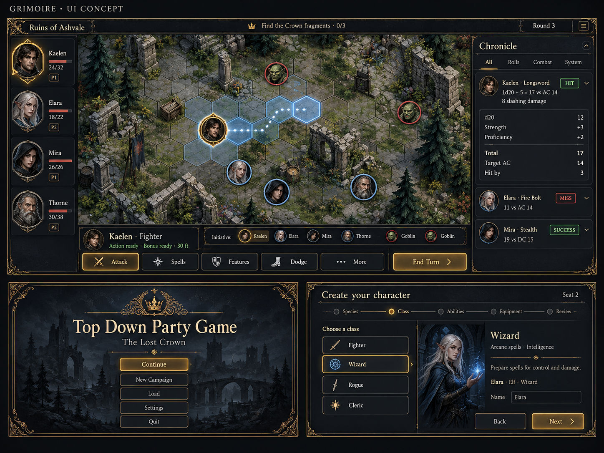
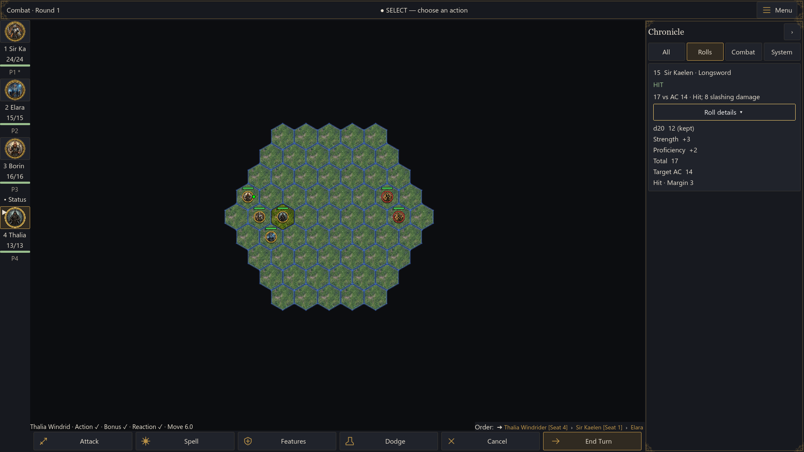
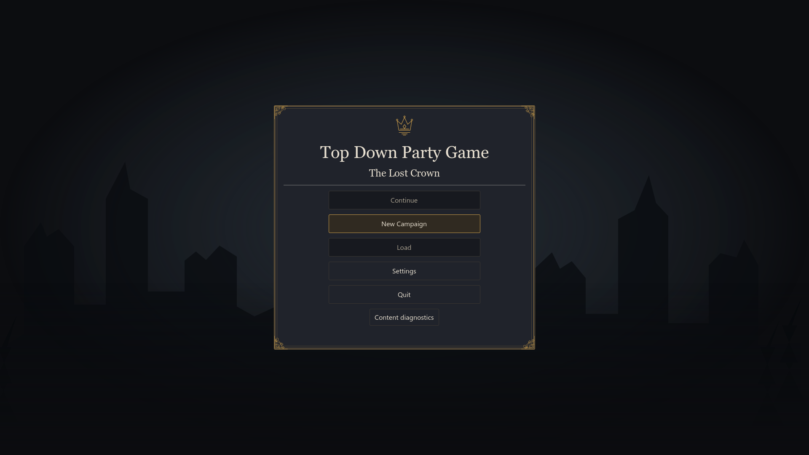
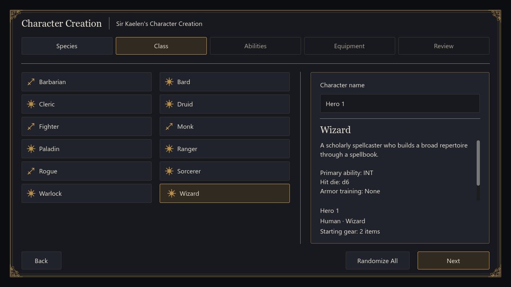

# Grimoire UI comparison and acceptance

Implemented 2026-10-04 against the owner's approved concept. The concept's
large gameplay panel and smaller menu/creation panels represent separate
screens. Exact geometry follows the Player UI Contract; terrain and character
art in the concept are illustrative.

## Approved reference

## Implemented presentation

| Approved direction | Delivered behavior |
| --- | --- |
| Soot/slate, parchment and aged brass | Shared semantic profile, engraved frames and consistent control states |
| Classical headings, clear body text | System Georgia/Segoe UI with serif/sans fallbacks; body defaults to 16 px |
| Board dominates gameplay | Same shell in combat, overworld and dungeon; independently scrolling Chronicle |
| Compact party status | Existing token portraits, identifiable short names/full-name tooltips, HP values/bar, status/down label, actor/selection markers and seat ownership |
| Clear current action | Combat actor, Action/Bonus/Reaction/Move and applicable Focus; labeled icon actions and far-edge End Turn |
| Readable roll history | Stored dice/modifiers/target/margin, outcome badges, hover/focus/pinned detail, filters and New navigation |
| Coherent player journey | Title, campaign/load selection, five-step creation, settings, sheets, roster, shop, event decisions, reaction prompts and terminal outcomes |
| Spacious monitor layout | Native resizing with a 720p floor; larger windows gain board area rather than stretching controls |

The implementation retains the project's terrain and tokens. It does not
promise the concept's illustrative map, painted portraits or full rules
support merely because those features appear in a mockup. The narrower
72-pixel party rail intentionally follows the accepted contract.

## Screen evidence

Captures use real production scenes with controlled fixture state. Journal
notices, the displayed example roll and event wording are explicit fixtures;
the fresh-process probe separately uses an actual weapon resolver result.
AI turns can change party HP between captures. All files are retained under
`reference/implemented/` as intentional review artifacts.

| Screen/state | 1280 × 720 | 1920 × 1080 |
| --- | --- | --- |
| Title | [capture](reference/implemented/menu-1280x720.png) | [capture](reference/implemented/menu-1920x1080.png) |
| Campaign setup | [capture](reference/implemented/campaign-selector-1280x720.png) | [capture](reference/implemented/campaign-selector-1920x1080.png) |
| Character creation | [capture](reference/implemented/creation-1280x720.png) | [capture](reference/implemented/creation-1920x1080.png) |
| Settings | [capture](reference/implemented/settings-1280x720.png) | [capture](reference/implemented/settings-1920x1080.png) |
| Combat | [capture](reference/implemented/combat-1280x720.png) | [capture](reference/implemented/combat-1920x1080.png) |
| Combat roll arithmetic/focus | [capture](reference/implemented/combat-rolls-1280x720.png) | [capture](reference/implemented/combat-rolls-1920x1080.png) |
| Collapsed Chronicle | [capture](reference/implemented/combat-collapsed-1280x720.png) | [capture](reference/implemented/combat-collapsed-1920x1080.png) |
| Party inspector | [capture](reference/implemented/combat-inspector-1280x720.png) | [capture](reference/implemented/combat-inspector-1920x1080.png) |
| Reaction decision | [capture](reference/implemented/reaction-1280x720.png) | [capture](reference/implemented/reaction-1920x1080.png) |
| Overworld | [capture](reference/implemented/overworld-1280x720.png) | [capture](reference/implemented/overworld-1920x1080.png) |
| Dungeon | [capture](reference/implemented/dungeon-1280x720.png) | [capture](reference/implemented/dungeon-1920x1080.png) |
| Character sheet | [capture](reference/implemented/overworld-sheet-1280x720.png) | [capture](reference/implemented/overworld-sheet-1920x1080.png) |
| Camp roster | [capture](reference/implemented/roster-1280x720.png) | [capture](reference/implemented/roster-1920x1080.png) |
| Merchant/tavern | [capture](reference/implemented/shop-1280x720.png) | [capture](reference/implemented/shop-1920x1080.png) |
| Event choices | [capture](reference/implemented/event-1280x720.png) | [capture](reference/implemented/event-1920x1080.png) |
| Victory | [capture](reference/implemented/victory-1280x720.png) | [capture](reference/implemented/victory-1920x1080.png) |
| Final Chronicle | [capture](reference/implemented/final-chronicle-1280x720.png) | [capture](reference/implemented/final-chronicle-1920x1080.png) |
| Defeat | [capture](reference/implemented/defeat-1280x720.png) | [capture](reference/implemented/defeat-1920x1080.png) |

Additional evidence: [1440p](reference/implemented/overworld-2560x1440.png),
[ultrawide](reference/implemented/overworld-3440x1440.png),
[alternate-profile title](reference/implemented/second-profile-1280x720.png),
[alternate-profile gameplay](reference/implemented/second-profile-gameplay-1280x720.png).
The alternate fixture changes surfaces, text, accents, ornament, icons and
spacing through the profile without gameplay branches on a profile ID.

## Geometry and contrast

| Native window | Open-rail board area |
| --- | --- |
| 1280 × 720 | 888 × 600 |
| 1920 × 1080 | 1468 × 960 |
| 2560 × 1440 | 2108 × 1320 |
| 3440 × 1440 | 2988 × 1320 |

The probe asserts these bounds in production scenes, rejects chrome points
as world input, and retains pan/zoom when the Chronicle collapses. The compact
inspector stays within the board edge. Essential controls fit at 720p;
long content scrolls inside its own pane.

WCAG relative-luminance ratios were measured against all four opaque chrome
surfaces, including selected controls. The lowest result for each role is:

| Foreground | Minimum ratio |
| --- | ---: |
| Body/arithmetic/button text | 10.83:1 |
| Muted text | 5.55:1 |
| Essential brass accent/icons | 5.49:1 |
| Success | 6.77:1 |
| Warning | 5.72:1 |
| Danger | 5.28:1 |
| Information | 6.15:1 |
| Focus ring | 8.98:1 |

Body text meets 4.5:1; the focus ring exceeds 3:1. Low-opacity ornament is
decorative. World terrain/entity art is outside the chrome contrast audit.
The numeric audit is retained as `reference/implemented/contrast.json`.

Visible widgets consume profile roles and Theme variations. Source inspection
found no gameplay branches on the profile ID. Existing authored per-node theme
colors are removed when styling scenes; dynamic state colors are semantic.
Old colored BBCode in hidden log adapters is stripped before narrative records
enter the Chronicle. World identity/state colors remain a separate boundary.

## Validation and limits

- Windows Godot 4.7 production rendering/input probe: zero failed checks and
  no script/runtime errors. Hover, focus and pinned expansion expose the same
  stored detail; New preserves reading position and returns to the bottom.
- Actual pointer input over a real hex beneath the character sheet is blocked;
  Tab stays inside, Escape closes the sheet and restores the opener. Settings
  and reaction decisions block world input. The Camp Roster integration checks
  movement and turn-changing controls under its modal.
- Creation preserves an edited name and choices across backward navigation,
  and selecting a choice preserves its keyboard control.
- Separate prepare/recover processes both pass. Continue finds the newest
  validated safe save and resolver-authored attack detail renders identically
  after JSON persistence. The history remains bounded to 200 complete records.
- Logic suite: 1,635 passed, zero failed. Bootstrap, 92-script parse gate and
  boot gate pass. The full integration run passed 38 of 41 scenarios; targeted
  Ranger and Fighter reruns pass after their assertions count structured
  attack cards separately from narrative feedback. Camp Roster also passes
  after the final modal changes. The resulting verified set is 40 of 41.
- `normal_creation_matrix` passes the one-through-four-player journey but
  retains 17 failures in its old class-specific expectations: old starting
  equipment/spells, automatic Paladin/Ranger style grants and Artificer exposure.
  Current class data differs and Artificer is outside the core-12 milestone.
  Those mechanics/test discrepancies were not rewritten to declare this UI
  work green. The full integration suite therefore remains non-green.

Disposable evidence roots are `.artifacts/grimoire-captures`,
`.artifacts/grimoire-relaunch`, `.artifacts/grimoire-final-check`,
`.artifacts/grimoire-acceptance-final` and `.artifacts/grimoire-targeted-final`.
All runs isolate player profile roots. Reproduction commands are in
[testing](../testing.md).
Selected pass markers are preserved in `reference/implemented/capture.txt`
and the two `relaunch-*.txt` files. `source-snapshot.json` records the working
tree at delivery, including concurrent mechanics changes; it is not a commit
or separate release identity.

This is Windows rendered-scene and automated input evidence, not a complete
manual campaign playthrough or cross-platform font/render certification.
System fonts require target-host verification elsewhere. No new resolver
arithmetic coverage, networking, controllers, rules migration, audio assets
or publication is part of the polish. Reduced interface motion is a saved
setting; existing game audio/feedback behavior is retained.
