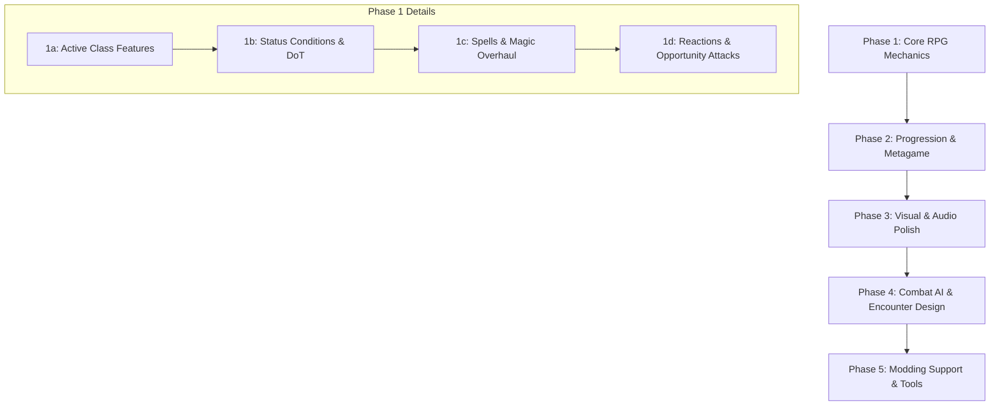

# Development Roadmap: Top Down Party Game

This roadmap outlines the long-term development strategy and implementation order for the D&D-inspired top-down turn-based party game. The priorities have been structured to establish a solid foundation of RPG mechanics before moving into campaign progression, polish, and advanced tools.

---

## Current Project State Summary

The codebase has functional foundations:
- **Core Systems**: JSON data loader ([data_loader.gd](file:///run/media/pigeon/890dd7cb-9753-4f6b-b8e6-58c98e531754/Projects/Top Down Party Game/src/autoload/data_loader.gd)) with mod override support.
- **Grids & Movement**: Hex coordinate math, pathfinding, and vision fog.
- **Exploration**: Turn-based overworld traversal ([overworld_state.gd](file:///run/media/pigeon/890dd7cb-9753-4f6b-b8e6-58c98e531754/Projects/Top Down Party Game/src/overworld/overworld_state.gd)) and procedural dungeon generation/exploration ([dungeon_state.gd](file:///run/media/pigeon/890dd7cb-9753-4f6b-b8e6-58c98e531754/Projects/Top Down Party Game/src/dungeon/dungeon_state.gd)).
- **Combat Loop**: Basic initiative tracker, player/monster entity spawning, basic attack/spell casting, and end-combat conditions ([combat_state.gd](file:///run/media/pigeon/890dd7cb-9753-4f6b-b8e6-58c98e531754/Projects/Top Down Party Game/src/combat/combat_state.gd)).

---

## Phase 1: Core RPG Mechanics & Rules (COMPLETED)

All D&D-inspired core tactical combat features, conditions, spells, reactions, and automated unit tests have been successfully implemented:

- **[x] Phase 1a: Active Class Features & Resources**
  - **HUD Integration**: Connected "Class Features" button in [combat_hud.gd](file:///run/media/pigeon/890dd7cb-9753-4f6b-b8e6-58c98e531754/Projects/Top Down Party Game/src/combat/combat_hud.gd) to open the features list popup and display remaining uses in the sidebar.
  - **Fighter's Features**: *Second Wind* rolls 1d10+Level self-healing; *Action Surge* is a free action that resets the turn action.
  - **Rogue's Cunning Action**: Grants free Dash (speed double), Disengage (adds condition to disable opportunity attacks), and Hide (Stealth roll vs perception DC 12).
  - **Rogue's Sneak Attack**: Validates Rogue eligibility, advantage, or adjacent alive allies. Adds extra damage dice, which double on critical hits.
  - **Resource Depletion**: Triggers once-per-turn resets on turn start.

- **[x] Phase 1b: Status Conditions & Damage-over-Time**
  - **Condition Registries**: Supported poisoned, stunned, blinded, prone, hidden, dodging, and disengaging conditions.
  - **Mechanics Resolution**:
    * *Poisoned*: Ticks `1d4` poison DoT at turn start, applies Disadvantage to attacks.
    * *Stunned*: Automatically skips the turn.
    * *Blinded*: Disadvantage on attacks, attackers gain Advantage on them.
    * *Prone*: Halves remaining movement speed, adjacent attackers gain Advantage, ranged attackers get Disadvantage.
  - **Token Indicators**: Renders distinct colored circle indicator rings around tokens in [hex_grid.gd](file:///run/media/pigeon/890dd7cb-9753-4f6b-b8e6-58c98e531754/Projects/Top Down Party Game/src/hex/hex_grid.gd).

- **[x] Phase 1c: Spells & Magic System Overhaul**
  - **Wizard's Arcane Recovery**: Free action to recover expended spell slots with combined level up to half Wizard level.
  - **Concentration**: Taking damage prompts a Constitution saving throw `DC = max(10, damage / 2)` to maintain a concentration spell. Knockouts end concentration.
  - **Lasting Spell Buffs/Debuffs**:
    * *Bless*: Adds `+1d4` to attack rolls and saves.
    * *Sleep*: Depletes an HP pool of `5d8` to put targets to sleep (stunned condition) from lowest HP upwards.
    * *Mage Armor*: Sets base AC to `13 + DEX`.
    * *Shield*: Reaction-based spell giving `+5` AC to turn a hit into a miss.

- **[x] Phase 1d: Combat Reactions & Opportunity Attacks**
  - **Opportunity Attacks**: Triggered when a player or enemy moves out of reach from an adjacent foe (distance moves 1 -> >1). Interrupted on KO. Rogue's disengage correctly bypasses this.
  - **Reactive Features**:
    * *Shield*: reaction spell to boost AC.
    * *Uncanny Dodge*: reaction to halve incoming attack damage.
    * *Counterspell*: reaction spell to cancel casting of targeted spells.
    * *Evasion*: passive feature where succeeding a DEX save yields 0 damage, failing yields half damage.

---

## Phase 2: Progression & Metagame

*Goal*: Build the loop connecting exploration, rewards, and character maintenance.

| Feature | Description | Target Files |
| :--- | :--- | :--- |
| **Overworld resting** | Allow players to rest on the overworld map. Resting in towns is safe. Resting in wilderness triggers an encounter check (ambush). | [overworld_state.gd](file:///run/media/pigeon/890dd7cb-9753-4f6b-b8e6-58c98e531754/Projects/Top Down Party Game/src/overworld/overworld_state.gd) |
| **Town Shops / Trading** | Spend collected gold. Buy consumables, better armor (Heavy/Medium), or martial weapons. | New `shop.tscn`, [overworld_state.gd](file:///run/media/pigeon/890dd7cb-9753-4f6b-b8e6-58c98e531754/Projects/Top Down Party Game/src/overworld/overworld_state.gd) |
| **Campaign Save/Load** | Persist campaign progress, player levels, locations, and inventory to file system. | New `save_manager.gd`, [game_manager.gd](file:///run/media/pigeon/890dd7cb-9753-4f6b-b8e6-58c98e531754/Projects/Top Down Party Game/src/autoload/game_manager.gd) |

---

## Phase 3: Visual & Audio Polish (Juice)

*Goal*: Make the interface look and feel responsive, modern, and premium.
- **Visual Effects (VFX)**:
  - Add particle systems for spell casting (e.g. fireballs, magic missiles flying).
  - Add screen shake on crits or high damage spells.
  - Implement damage floaty text numbers.
- **UI & Layout Enhancements**:
  - Modernize HUDs with glassmorphic borders, clean typography, and smooth transitions.
  - Add hover details for tiles, monsters, and player actions.
- **Audio Feedback**:
  - Trigger ambient overworld music and battle tracks.
  - Add sound effects (SFX) for hits, misses, spell casts, and dice rolls.

---

## Phase 4: Combat AI & Encounter Design

*Goal*: Make enemies act intelligently and design exciting boss fights.
- **Behavioral Profiles**:
  - Support healer/support AI (seeks injured allies and casts healing spells).
  - Support caster AI (stays at range, casts AoE spells to hit multiple players).
  - Support cowardly AI (flees when HP is low or retreats to allies).
- **Boss Fight States**:
  - Introduce multi-phase bosses (e.g. the Lich King summons skeletons at 50% HP).
  - Environmental hazard triggers during boss fights.

---

## Phase 5: Modding Support & Tools

*Goal*: Open up the engine for user-created content.
- **In-Game Mod Manager**:
  - UI to scan, load, enable/disable mod files in `data/mods/`.
  - Validate mod schema integrity before launching.
- **Visual Editors**:
  - Map/Campaign Creator: Paint hex terrains, place town/dungeon locations, and specify custom milestone events.
  - Character Class / Monster builder.
