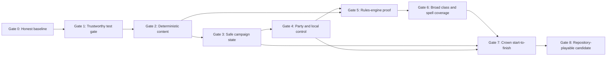

# Crown Campaign Recovery and Delivery Roadmap

**Status:** Canonical execution roadmap

**Updated:** 2026-08-10

**Milestone:** Playable Crown campaign, start to finish, from the repository

**Engine baseline:** Godot 4.7.x

**Supported validation host:** Windows. `run_tests.ps1` is the milestone gate;
`run_tests.sh` is retained as a compatibility helper and does not require native
Linux execution evidence.

This roadmap replaces the earlier phase-completion claims. A feature is not complete because a button, description, data record, or isolated resolver exists. It is complete when the production path and relevant automated gates prove the intended result. Short human sampler checks may expose feel, readability, or wiring defects, but a full manual playthrough is not a standing blocker for this casual project.

`docs/ROADMAP_FUTURE.md` remains an idea backlog. It does not set current priorities.

---

## 1. Milestone outcome

The first milestone is a private, repository-run game in which one to four
shared-keyboard local players can create characters, recruit companions into
empty party slots, complete the Crown campaign, defeat its final encounter,
and reach a provisional ending.

The target experience is a broad and mechanically deep tabletop RPG in a top-down pixel-art presentation. Breadth does not permit decorative mechanics: every option exposed to a player must work.

### Product contract

- The active party contains at most four characters.
- Each local player creates one player character.
- Recruitable companions may fill remaining party slots.
- One exploration leader moves the party as a unit.
- Followers have a visual formation but no authoritative independent exploration position.
- Every active character, including companions, is assigned to a local player for combat decisions.
- One player may control multiple characters.
- Leadership and logical seat assignments can be changed outside combat and blocking conversations.
- Saving is supported only at explicit safe locations or states. Mid-combat and active-dungeon saves are rejected.
- Crown is the target baseline campaign; this is not a current completion claim.
- Campaign completion ends at a provisional completion screen. New Game+, ascension, and post-game play are future systems.
- Current 5E-derived content is for private play. Rules, content, presentation, and campaign data must remain separable so private content can later be replaced.

### Explicit non-goals for this milestone

- Online multiplayer or rollback networking
- Public distribution or storefront packaging
- A mod manager or visual content editor
- Independent split-party exploration
- New Game+, ascension, or a complete post-game loop
- Mechanics beyond the Crown campaign's confirmed level cap
- Public-release licensing clearance

Export support may be developed opportunistically, but the milestone gate requires a documented repository setup and launch path, not a packaged build.

---

## 2. Delivery rules

These rules apply to every task and gate.

1. **Normal-path proof:** Tests must construct characters and content through the same loaders and creation paths used by players. Test-only injection may test a resolver, but cannot prove a feature is wired.
2. **No decorative options:** An ability, spell, item, setting, or action with no implemented effect must be hidden, rejected with a clear explanation, or completed before the gate passes.
3. **Production-data proof:** At least one test per player-facing mechanic must use the production record by stable ID.
4. **Deterministic content:** Load order and override behavior must not depend on filesystem enumeration.
5. **Safe persistence:** Save files contain versioned data transfer objects, never live Godot objects, scene nodes, input-device IDs, or stringified engine types.
6. **Named integration tests:** Each integration scenario owns its scene/process lifecycle, timeout, log, and result. One scenario cannot prevent later scenarios from running.
7. **Evidence before status:** A gate is complete only when its evidence is recorded. Passing assertions alone does not override engine errors, skipped scenarios, or an unreachable player path.
8. **Debug/release boundary:** Developer control surfaces may exist in development, but must be visibly gated and absent from any friend-facing launch configuration.
9. **Documentation follows behavior:** Status documents are updated in the same change that alters shipped behavior.
10. **One vertical path stays playable:** After Gate 3, every later gate must preserve a known-good start-to-finish development path, even while content coverage expands.

### Task states

- `pending`: accepted but not started
- `in_progress`: owned and actively changing
- `blocked`: cannot proceed without a named decision or prerequisite
- `review`: implementation and automated checks complete; human or full-flow validation remains
- `done`: acceptance criteria and required gate evidence are recorded

---

## 3. Critical path



Gates are sequential on the critical path. Work may be prepared in parallel, but a later gate cannot be declared complete while an earlier gate remains open.

### Current review position (2026-08-10)

The current working tree has completed **Gate 1 regression recovery**. The
Bardic Inspiration fixture now seeds its d20 input while exercising the real
optional reaction path, and two consecutive complete Windows runs passed every
named scenario with exit code `0`.

| Gate | State | What remains before it can advance |
|---|---|---|
| 0 | `done` | Nothing in this review. Confirmed defects continue under their owning later gates. |
| 1 | `done` | Nothing in this review. The deterministic fixture and two complete Windows runs are recorded in [Gate 1 evidence](docs/gate1_evidence.md). |
| 2 | `done` | Nothing in this review. Importer execution, cross-process registry digest, and quarantined-content promotion review are recorded in [Gate 2 evidence](docs/gate2_evidence.md). |
| 3 | `done` | Exercise process interruption and a fresh relaunch against repository-owned save fixtures. |
| 4 | `done` | Nothing in the milestone roadmap. Shared-keyboard hot-seat is the accepted local multiplayer boundary; physical controller acceptance is post-Gate 8. |
| 5 | `in_progress` | Fix the confirmed Rogue starting-equipment and Ranger mark/action-flow defects, then rerun the agent-owned acceptance audit. |
| 6 | `in_progress` | Complete cohorts B–D and the exposed spell, item, Crown monster, condition, AI-parity, and balance audits. |
| 7 | `in_progress` | Automated CROWN-09 composition rows and two named CROWN-10 fresh-process probes pass; decide the gate after the confirmed normal-path defects are fixed. Optional Crown sampler notes are nonblocking. |
| 8 | `in_progress` | Publication-only provenance, cleanup, fresh-clone, and friend-run checks are parked until publication is actually wanted. A full manual playthrough does not block casual development. |

Execution is coordinated through the shared [Quest Board](.questboard/README.md).
The remaining roadmap is split into dependency-ordered cards sized for one
30–60 minute implementation slice. The board keeps one obvious `ready` card;
optional human sampling, publication, friend-run, cleanup, and controller work
stays parked until it is wanted.

---

## 4. Gate 0 — Honest baseline

**Objective:** Make the repository tell the truth about what works, what is reachable, and what remains unverified.

**Current evidence:** [Gate 0 evidence](docs/gate0_evidence.md), [feature matrix](docs/feature_matrix.md), [Crown campaign band](docs/crown_campaign_band.md), and [confirmed defect register](docs/defect_register.md). Status: `done`; the recorded P0/P1 defects are carried into later gates.

| ID | Priority | Task | Acceptance criteria |
|---|---:|---|---|
| BASE-01 | P0 | Replace stale completion claims | This roadmap is canonical; architecture and changelog entries no longer describe unwired class features, spells, save-anywhere, or skipped integration scenarios as complete. |
| BASE-02 | P0 | Establish supported engine version | Godot 4.7.x is documented; the exact validation version is recorded; launch commands do not rely on a developer-specific absolute path. |
| BASE-03 | P0 | Inventory player-facing features | Produce a generated matrix of classes, levels, features, spells, items, conditions, settings, scenes, and whether each is loaded, reachable, implemented, and tested. |
| BASE-04 | P0 | Register confirmed defects | Track duplicate IDs, empty feature effects, empty class spell lists, broken save state, missing terminal scenes, repeatable milestones, test-harness destruction, and runtime Beckett exposure as owned work items. |
| BASE-05 | P1 | Confirm Crown campaign band | Record starting level, intended final level, required dungeons, required milestones, final encounter, and minimum companion roster. Current planning assumes levels 1–5 until this inventory proves otherwise. |
| BASE-06 | P1 | Separate evidence from generated debris | Ignore or relocate disposable logs and generated dogfood output. Preserve intentional fixtures. Stale error logs must not look like current failures. |

### Gate 0 exit

- One feature matrix exists and is reproducible.
- Every confirmed P0/P1 defect has an owner or explicit `pending` status.
- No roadmap section labels a feature complete without a normal-path proof.
- Main boot behavior and current test counts are recorded against a named Godot build.

---

## 5. Gate 1 — Trustworthy test and developer loop

**Objective:** A green test command must mean the project parsed, booted, executed every named scenario, and exited without unexpected engine errors.

**Current evidence:** [Gate 1 evidence](docs/gate1_evidence.md). Status:
`in_progress` due to a regression in the current working tree. The committed
baseline remains valid at 263 assertions, but the expanded 521-assertion suite
produced one green review run and one failing review run. The Bardic Inspiration
fixture must be made deterministic and the complete runner must return to green
before later gates can advance.

| ID | Priority | Task | Acceptance criteria |
|---|---:|---|---|
| TEST-01 | P0 | Replace file-by-file `--script` preflight | Bootstrap a clean checkout's ignored Godot class cache, then parse in project context so autoload identifiers resolve. The gate reports real parse failures without falsely rejecting valid project scripts. |
| TEST-02 | P0 | Isolate viewport scenarios | Combat boot, AI loop, victory, overworld, dungeon, event, character creation, shop, save/load, settings, and character sheet each run in a fresh Godot process or fully isolated tree. |
| TEST-03 | P0 | Add hard timeouts and result markers | Every scenario has a bounded runtime, explicit pass marker, non-zero failure exit, and captured log. Timeout is a failure, never an apparent success. |
| TEST-04 | P0 | Treat engine errors as failures | Unexpected `SCRIPT ERROR`, parse errors, invalid calls, leaked test-owned nodes, and resource errors fail the owning scenario. Document narrowly allowed warnings. |
| TEST-05 | P0 | Provide the supported Windows entry point | Add a PowerShell runner that resolves an environment-provided or explicit portable Godot executable without hard-coded home paths. Retain the shell runner as compatibility-only tooling. |
| TEST-06 | P1 | Split logic and integration suites | Fast logic checks run first and scene integration runs second; each can be invoked alone. The fixed-seed campaign smoke is introduced and owned by Gate 7. |
| TEST-07 | P1 | Isolate save and settings data roots | Tests use disposable `user://` roots and cannot consume or alter a developer's real saves/settings. |
| TEST-08 | P1 | Publish a concise test manifest | List every named test scenario and the player-facing contract it covers. A test count without a contract map is not sufficient. |

### Gate 1 exit

- A clean checkout has one documented Windows test command. The compatibility shell runner is not completion evidence.
- Intentionally breaking an autoload reference fails the parse/boot gate quickly.
- Intentionally hanging one viewport scenario fails that scenario and does not hide the results of the others.
- The complete suite produces an enumerated pass/fail result and no unexplained Godot `ERROR` output.
- The Gate 1 baseline remained green at 263 assertions; later gate work expanded the current suite to 521 assertions, with the historical count explained in the evidence.

---

## 6. Gate 2 — Deterministic, validated content

**Objective:** Production data loads predictably, preserves curated mechanics, and fails loudly when content is ambiguous or structurally invalid.

**Current checkpoint (2026-08-10):** DATA-01 through DATA-10 have implementation,
clean-room, and promotion-review evidence. The importer passed against
`G:\linux\5etools-src\data` without changing `data/core`; staged source/core
overlaps remain recorded and unsupported effectless records remain quarantined.

| ID | Priority | Task | Acceptance criteria |
|---|---:|---|---|
| DATA-01 | P0 | Define content layers and precedence | Separate imported source material, curated mechanical records, campaign content, and future user packs. Precedence is explicit and documented. |
| DATA-02 | P0 | Detect duplicate IDs | CI fails on unapproved duplicate class, race, item, spell, monster, event, and campaign IDs. Intentional overrides require an explicit manifest entry naming the replaced source. |
| DATA-03 | P0 | Sort all discovery | Directory and file iteration is explicitly sorted and repeated Windows loads produce identical registry hashes. |
| DATA-04 | P0 | Preserve curated spell mechanics | Imported descriptive records cannot erase curated `effects`, action economy, targets, saves, concentration, or class-list assignments. `bless` and `shield` are regression fixtures. |
| DATA-05 | P0 | Populate class spell access | Character creation and level-up produce correct known/prepared spell choices from production data. A newly created caster reaches combat with a usable spell. |
| DATA-06 | P0 | Validate executable features | Active features require supported effects or a named custom resolver. Effectless active features are rejected by validation. |
| DATA-07 | P1 | Add schemas and semantic validation | Validate required fields, stable references, dice expressions, enum values, effect parameters, target types, resource cadence, and cross-record IDs before registration. |
| DATA-08 | P1 | Make import tooling portable | Remove developer-specific source paths, accept explicit inputs/outputs, avoid modifying curated files, and emit a collision/coverage report. |
| DATA-09 | P1 | Define content-pack manifest | Core and Crown content each have identity, version, dependencies, and ruleset compatibility. This is an internal boundary, not a user-facing mod manager. |
| DATA-10 | P1 | Add registry diagnostics | Development boot prints counts, active content layers, approved overrides, and validation failures without flooding normal player logs. |

### Gate 2 exit

- Zero unapproved ID collisions.
- Registry hashes match across repeated Windows runs, with no reliance on filesystem enumeration order.
- Every active feature has an executable effect or registered resolver.
- Every exposed caster receives legal production spell options.
- Production `bless`, `shield`, Second Wind, and one imported item/monster pass mechanics-backed regression tests.
- Re-running the importer cannot silently degrade curated gameplay records.

---

## 7. Gate 3 — Safe saves and idempotent campaign state

**Objective:** Supported saves round-trip without duplicating rewards, losing party state, or serializing live engine objects.

**Current checkpoint (2026-08-09):** SAVE-01 through SAVE-08 have an automated
implementation pass and are recorded as `done` in [Gate 3 evidence](docs/gate3_evidence.md).
The repository-owned v1 fixture, corrupt-save transactional test, atomic backup
recovery, real host process interruption, and fresh-process relaunch are green.

| ID | Priority | Task | Acceptance criteria |
|---|---:|---|---|
| SAVE-01 | P0 | Define safe-save policy | Save is allowed at the overworld, town/camp, and designated dungeon-entry checkpoints. It is disabled and rejected during combat, event resolution, scene transitions, and active dungeon traversal. |
| SAVE-02 | P0 | Add schema versioning | Every save has a schema version, game/content version, creation/update timestamp, and validated root structure. Unsupported versions fail without replacing active state. |
| SAVE-03 | P0 | Replace runtime objects with DTOs | Coordinates, rooms, inventories, characters, milestones, dungeons, party slots, and companion state serialize to plain dictionaries/arrays and reconstruct through explicit `to_dict`/`from_dict` paths. |
| SAVE-04 | P0 | Persist campaign ledgers | Completed milestones, cleared dungeons, claimed rewards, boss defeats, recruited/dismissed companions, and campaign completion are stored by stable ID. |
| SAVE-05 | P0 | Make rewards idempotent | Re-entering a cleared dungeon or re-evaluating a milestone cannot grant levels, gold, fragments, loot, or achievements twice unless the content explicitly declares repeatability. |
| SAVE-06 | P1 | Add transactional load | Parse and validate into temporary state. Replace active game state only after the complete save is accepted. A corrupt save leaves the current session intact. |
| SAVE-07 | P1 | Add save compatibility fixtures | Keep representative saves for the current schema and future migration tests. Fixtures contain no developer-specific paths or private player data. |
| SAVE-08 | P1 | Test repeated round-trips | Create, save, load, progress, save, and load again using a disposable data root. Compare stable gameplay state, not serialized string equality alone. |

### Gate 3 exit

- Save controls are unavailable in every unsafe state and API calls are rejected defensively.
- No save JSON contains `<RefCounted`, `Node`, raw `Vector2i` strings, callable values, or device IDs.
- A three-cycle save/load test preserves party, inventory, location, logical seat ownership, companion roster, milestones, and cleared dungeons.
- Replaying a cleared Crown dungeon cannot duplicate its one-time rewards.
- Corrupt and unsupported saves fail safely with a player-readable message.

---

## 8. Gate 4 — Party, companions, and shared-keyboard local control

**Objective:** Model characters, active party membership, and logical local
control separately so two or more people can share the keyboard in hot-seat
play now and device-specific or networked control can be added later.

**Current checkpoint (2026-08-10):** PARTY-01 through PARTY-08 have an
implementation pass: four stable slots, local seats, campaign companions,
leadership, party-derived combat participants, and overworld roster controls.
A four-member composition scenario proves ownership and distinct formation
positions. PARTY-08 now treats common keyboard input as hot-seat intent for the
active logical seat, and PARTY-10 has a shared `PlayerCommand` boundary for exploration, event, and
inventory intents alongside `CombatCommand`. Broader command routing and
formation validation now includes supported save/load before combat entry.
Optional physical Start binding, disconnect/reconnect callbacks, held owned
turns, and post-load rebinding are implemented without serializing device IDs,
but physical hardware acceptance is outside the milestone gates. The production
Camp Roster closes the companion lifecycle gap with recruit,
decline/reconsider, dismiss, replacement, and logical-seat assignment controls.

**Current evidence:** [Gate 4 evidence](docs/gate4_evidence.md). Status:
`done`; normal-path creation, deterministic ownership, shared-keyboard hot-seat
control, modal-input isolation, spell ownership, supported save/load, and
formation checks pass. Physical controller binding and unplug/replug acceptance
are deferred to the post-Gate-8 roadmap by product decision.

| ID | Priority | Task | Acceptance criteria |
|---|---:|---|---|
| PARTY-01 | P0 | Introduce stable party slots | Four ordered slots reference character IDs and expose empty/occupied state. Character data does not own input or seat identity. |
| PARTY-02 | P0 | Introduce local player seats | A local seat has a stable session ID, display identity, color, joined state, and assigned party slots. Shared-keyboard play does not require one physical device per seat. |
| PARTY-03 | P0 | Build 1–4 player join/create flow | Each joined player creates exactly one initial character. Starting the campaign with fewer than four leaves legal companion slots. |
| PARTY-04 | P0 | Add companion recruitment lifecycle | Crown exposes a minimum roster sufficient to fill a one-player party. Recruit, decline, dismiss, and replace operations enforce party capacity and unique companion identity. |
| PARTY-05 | P0 | Implement exploration leadership | One occupied slot is leader. Input moves the party once, followers render in formation, and events/transitions trigger from the authoritative party position. |
| PARTY-06 | P0 | Assign all combatants to players | Before combat, every active character has exactly one local owner. Companions can be redistributed among joined players; one player may own several turns. |
| PARTY-07 | P1 | Add leadership and assignment UI | Outside blocked states, players can transfer leadership and reassign companions. Current leader and active combat owner are always visible. |
| PARTY-08 | P1 | Support shared-keyboard hot-seat | Every joined logical seat and every character it owns receives the correct turn through the common keyboard controls. Physical device assignment is not a milestone requirement. |
| PARTY-09 | P1 | Spawn coherent combat formations | Encounters derive all active combatants from the party snapshot and place them around the leader using validated formation positions. No member can be absent because of exploration distance. |
| PARTY-10 | P1 | Route intent through commands | Movement, action selection, targets, dialogue choices, inventory actions, and end-turn enter rules through explicit player commands rather than direct device events in domain logic. |

### Gate 4 exit

- Automated scenarios start Crown with 1, 2, 3, and 4 local players.
- Empty slots can be filled by distinct companions and reassigned among players.
- One leader moves the full exploration party and all active slots enter combat.
- A person controlling multiple characters receives the correct turns through the shared keyboard without changing logical seats.
- Save/load preserves party slots, characters, companion state, leadership, and logical seat ownership.

---

## 9. Gate 5 — Rules-engine proof through a representative cohort

**Objective:** Establish a reusable action/effect vocabulary and prove it with Fighter, Rogue, Wizard, and Cleric across the Crown level band.

**Current checkpoint (2026-08-10):** A first representative cohort is
implemented and recorded as `in_progress` in [Gate 5 evidence](docs/gate5_evidence.md):
Fighter Second Wind/Action Surge/Extra Attack, Barbarian/Monk/Paladin/Ranger
Extra Attack, Rogue Sneak Attack/Cunning Action, Wizard Arcane Recovery, and
Cleric spell-slot recovery. HUD combat input now crosses a
validated `CombatCommand` boundary; shared action/bonus-action budgets and
typed temporary-HP/resource/concentration effects are covered by the logic
suite. Monster decisions now cross a validated `AICommand` boundary before
movement or attacks execute. The broader effect, reaction, and class contracts
remain; timed AC/stat, roll, and movement modifiers are now part of the shared
effect vocabulary with persistence and turn expiry. Inventory now validates
item identity, equipment slot compatibility, ownership, and backpack capacity
at the domain boundary. Monster attacks now collect an owner-labelled,
in-shell reaction decision for Shield and Uncanny Dodge; test mode declines
immediately, and explicit accept/decline behavior is covered by deterministic
fixtures. Opportunity attacks now use the same owner-labelled reaction path;
Counterspell now scans eligible player observers once per player spell cast;
the wider reaction/class contracts remain.
The per-turn action, bonus-action, and reaction budget now lives in the tested
`CombatTurnBudget` boundary, and player plus AI movement steps cross the shared
`CombatAction.resolve_movement_step` result boundary before position mutation.
The named `mixed_mechanics_encounter` fixture now composes the required martial,
bonus-action, reaction, concentration, healing, save-spell, and area-selection
surfaces from production class and spell records.
The named `action_resource_round_trip` fixture now spends a production Fighter
feature and Wizard spell slot, saves at the overworld safe point, reloads through
the DTO boundary, and boots the next combat with the remaining resources.
Character resources now expose distinct
short-rest and long-rest methods; current camp, tavern, and dungeon rest use
the long-rest contract, with short-rest feature and spell-slot behavior covered
by deterministic fixtures.

| ID | Priority | Task | Acceptance criteria |
|---|---:|---|---|
| RULE-01 | P0 | Define command and action contracts | Move, attack, cast, use feature, use item, react, interact, and end turn have typed/validated request and result shapes. Invalid actions do not partially mutate state. |
| RULE-02 | P0 | Define effect vocabulary | At minimum support damage, healing, temporary HP, movement, resource spend/restore, condition add/remove, roll modifiers, AC/stat modifiers, summon, area selection, duration, concentration, and triggered reactions. |
| RULE-03 | P0 | Centralize action economy | Action, bonus action, reaction, movement, free interactions, per-turn uses, short-rest uses, long-rest uses, and spell slots are consumed and restored consistently. |
| RULE-04 | P0 | Separate combat responsibilities | Extract stable session state, turn progression, action resolution, and presentation/VFX boundaries from `CombatState` without changing validated behavior. |
| RULE-05 | P0 | Complete Fighter 1–5 | Starting proficiencies/equipment, Second Wind, Action Surge, subclass-independent features in scope, resources, and level progression are reachable and tested. |
| RULE-06 | P0 | Complete Rogue 1–5 | Sneak Attack, Cunning Action, Uncanny Dodge or other in-band features, skill interactions, resources, and progression are reachable and tested. |
| RULE-07 | P0 | Complete Wizard 1–5 | Spell acquisition/preparation policy, slots, Arcane Recovery, concentration, reactions, save/attack spells, and progression are reachable and tested. |
| RULE-08 | P0 | Complete Cleric 1–5 | Preparation, healing, buffs, save spells, Channel Divinity/in-band resources, concentration, and progression are reachable and tested. |
| RULE-09 | P1 | Implement reaction ownership flow | Opportunity attacks, Shield, Counterspell, Uncanny Dodge, and future reactions prompt the owning player, respect timeouts/cancel, and cannot consume another seat's input. |
| RULE-10 | P1 | Add deterministic rules fixtures | Seeded dice and fixed combat states test success, failure, criticals, advantage/disadvantage, saves, resistance, concentration, KO, death/defeat, and resource reset. |

### Gate 5 exit

- A newly created Fighter, Rogue, Wizard, and Cleric each reach level-appropriate combat with their expected production-data actions.
- Every in-band feature for the cohort is either mechanically complete or deliberately excluded from selection with a recorded scope decision.
- At least one full encounter uses martial attacks, a bonus action, a reaction, concentration, healing, a save spell, and an area effect.
- Action/resource state survives a supported save between encounters.
- `CombatState` no longer owns domain resolution, input interpretation, scene transitions, and presentation as one undivided responsibility.

---

## 10. Gate 6 — Broad class, spell, item, and monster coverage

**Objective:** Extend the proven rules contracts across every player option exposed within the Crown level band.

**Current checkpoint (2026-08-10):** The first Cohort B slice is now
mechanics-backed: Barbarian Rage is a production bonus-action feature using the
shared condition/modifier resolver, with physical weapon damage bonus and
resistance fixtures. Monk Patient Defense now applies the shared one-turn
Dodging condition, Step of the Wind now exposes Dash/Disengage through
per-turn bonus-action resources, and Monk Martial Arts/Bonus Unarmed Strike
now resolve through the shared melee attack boundary. Ranger Favored Foe now
marks post-hit targets and applies concentration-bound once-per-turn damage.
Monk Flurry of Blows now resolves two adjacent unarmed strikes as one per-turn
bonus-action contract through that same boundary.
Barbarian Reckless Attack now offers first-attack Strength melee advantage and
keeps the barbarian vulnerable to monster attacks until their next turn.
Paladin Divine Smite now prompts after a
melee hit and consumes a production spell slot for radiant damage. Paladin Lay
on Hands now uses a level-scaled rest-recharged healing pool with touch-range
ally targeting. Ranger Hunter's Mark now has curated level-1 access, bonus-action
target marking, concentration cleanup, and extra 1d6 damage on every weapon hit.
Paladin Divine Sense now detects nearby typed Crown creatures through curated
monster metadata, without relying on name matching.
Bardic Inspiration now grants an ally a level-scaled die through bonus-action
targeting and can be spent on that ally's next attack roll.
Warlock Pact Magic now uses curated pact-level slots, lets lower-level spells
consume the available pact slot, and restores those slots on a short rest.
Sorcerer Metamagic now exposes production Sorcery Points and an owner-facing
Empowered Spell choice that modifies damage through the shared spell resolver;
the points restore on a long rest.
Dart- and ray-based curated spells now resolve through shared multi-roll paths;
effect-only spells no longer fall through to invalid attacks. Mage Armor,
Cure Wounds, Ray of Frost, teleport destination validation, Warlock-aware slot
display, and reaction-only spell gating are covered by production-data tests.
Crown monster attack riders now use the same combat boundary for poison,
restraint, paralysis, armor corrosion, and maximum-hit-point reduction.
Barbarian Unarmored Defense, Ranger Archery, Paladin Defense Fighting Style,
Warlock Magical Cunning, Sorcerer Innate Sorcery, and Artificer Tinker's Magic
are now mechanics-backed through production data and the shared effect/resource
paths. Mystic psionics remains quarantined because no psi-point resource or
discipline resolver exists.
Druid Wild Shape remains explicitly quarantined from player selection until a
form roster and temporary-form persistence contract are implemented. The
proposed scope is recorded in [ADR-0002](docs/decisions/0002-wild-shape-crown-band.md)
and awaits human acceptance. The
remaining Cohort B class mechanics and the broader spell, item, monster, and
condition audits remain open.

**Current evidence:** [Gate 6 evidence](docs/gate6_evidence.md). Status:
`in_progress`; broad mechanics and encounter coverage remain implementation
work.

### Class cohorts

| Cohort | Classes | Required proof before next cohort |
|---|---|---|
| A | Fighter, Rogue, Wizard, Cleric | Gate 5 |
| B | Barbarian, Monk, Paladin, Ranger | Rage/stance resources, unarmed/multiattack behavior, smites, half-casting, and class-specific action economy work through production data. |
| C | Bard, Druid, Sorcerer, Warlock | Inspiration, wild-shape decision or explicit scope, metamagic, pact casting, short-rest restoration, and distinct spell-list behavior work. |
| D | Artificer, Mystic, remaining variants | Non-core rules are explicitly specified, mechanically implemented, and prevented from bypassing shared resource/effect contracts. |

### Coverage tasks

| ID | Priority | Task | Acceptance criteria |
|---|---:|---|---|
| CONTENT-01 | P0 | Build mechanics coverage report | Report every exposed class feature and spell with implementation status, resolver/effects, player path, and test IDs. The report is generated from production content. |
| CONTENT-02 | P0 | Complete cohorts B–D | Each class has legal creation choices, starting equipment, level progression, resources, class actions, and spells where applicable across the confirmed Crown band. |
| CONTENT-03 | P0 | Audit every exposed spell | Every selectable spell has casting time, range, targets, costs, resolution, feedback, AI compatibility where applicable, and at least one mechanics test. Hide unsupported spells. |
| CONTENT-04 | P0 | Audit items and equipment | Weapons, armor, shields, consumables, quest items, shops, inventory limits, equip restrictions, and gold transactions use validated production records. |
| CONTENT-05 | P0 | Audit monsters and encounters | Every Crown monster has valid actions, movement, defenses, rewards, AI profile, and encounter placement. Unsupported imported monsters remain unavailable. |
| CONTENT-06 | P1 | Complete condition interactions | Durations, stacking, immunity, removal, save timing, turn timing, concentration links, UI indicators, and persistence are defined and tested. |
| CONTENT-07 | P1 | Add AI action parity | AI consumes the same validated action/effect contracts as players. It cannot cast or use an ability through a private shortcut unavailable to rules validation. |
| CONTENT-08 | P1 | Balance the Crown band | Establish encounter budgets, resource attrition assumptions, rest availability, item economy, and expected party compositions for 1–4 players. |

### Gate 6 exit

- The coverage report has no exposed feature or spell in `missing`, `description-only`, or `test-only` state.
- All 14 current classes can be created and complete representative Crown encounters across their supported levels.
- Every Crown encounter record passes schema and mechanics validation.
- Unsupported imported content is quarantined from player selection rather than pretending to work.
- A mixed party can rest, level, equip rewards, prepare/learn spells, and retain state correctly between encounters.

---

## 11. Gate 7 — Crown campaign start to finish

**Objective:** Turn the working systems into one complete campaign with a visible beginning, progression, final encounter, defeat path, and provisional ending.

**Current checkpoint (2026-08-10):** CROWN-02 has a player-facing objective
API and overworld HUD display backed by party inventory, defeat ledgers, and
milestones. CROWN-04 now records a pending dungeon combat room and clears it
only after a production victory result, including boss state and save DTO
coverage. CROWN-05 now drives the real Lich King combat loop in the Crown
smoke, while `combat_defeat` exercises the live party-wipe boundary and
production defeat screen. CROWN-06 and CROWN-07 have terminal-screen implementations, and
`crown_smoke` now covers the bounded production path through overworld, dungeon,
event, finale composition, objective completion, and the provisional ending.
The named `crown_event_fairy_ring` fixture now proves one production chain event,
all three legal follow-up choices, deterministic DEX success/failure branches,
and their shared reward/condition/healing/teleport effects; this is one CROWN-03
event row, not the complete required-event ledger matrix. The named
`dungeon_reentry_round_trip` fixture now inspects the plain Room DTO checkpoint,
supported reload, cleared-room rebuild, and idempotent boss/reward revisit for
CROWN-04. The named `final_encounter_round_trip` fixture now covers the
production Lich King loss boundary, pre-finale safe reload, victory ledger,
idempotent reward claim, and completion screen for CROWN-05 through CROWN-07.
The named `crown_composition_solo_two` fixture now covers the first two CROWN-09
composition rows through production Camp Roster assignment, safe save/load,
objective visibility, combat ownership, and formation. The named
`crown_composition_three_four` fixture now covers the remaining three-player
plus one companion and four-player rows; normal shared-keyboard acceptance
remains manual. The named `scripts/validate_crown_fresh_relaunch.ps1` probe now
proves one true Crown overworld safe-point interruption/relaunch with restored
party ownership, objective, cleared dungeon, reward ledger, and available state;
broader CROWN-10 safe points and GUI relaunch remain.
The named `scripts/validate_crown_two_player_relaunch.ps1` probe also restores a
progressed two-seat Crown save with transferred leadership, two cleared
dungeons, two rewards, two fragments, and the Tower objective; interactive
midgame campaign traversal has not been manually sampled. That optional check
does not block the automated campaign contract.
Full campaign balance and interruption remain automation-owned evidence areas.

**Current evidence:** [Gate 7 evidence](docs/gate7_evidence.md). Status:
`in_progress`; the fixed-seed Crown smoke, defeat/completion paths, all four
CROWN-09 composition rows, and two named CROWN-10 fresh-process recovery probes
pass. Gate closure follows the agent-owned acceptance audit after confirmed
normal-path defects are fixed; optional shared-keyboard sampling is nonblocking.

| ID | Priority | Task | Acceptance criteria |
|---|---:|---|---|
| CROWN-01 | P0 | Define Crown campaign graph | Document required and optional locations, events, companion opportunities, dungeons, milestones, boss prerequisites, rewards, and final transition by stable ID. |
| CROWN-02 | P0 | Add player-facing objectives | The party can always determine its current primary objective and completed milestones without reading developer logs. |
| CROWN-03 | P0 | Complete event outcomes | Required events resolve legal choices, checks, rewards, consequences, companion changes, and follow-up state through shared rules and campaign ledgers. |
| CROWN-04 | P0 | Complete dungeon lifecycle | Entry, rooms, traps, encounters, loot, boss, clear state, exit, and re-entry behavior are deterministic where required and persist one-time results. |
| CROWN-05 | P0 | Complete final encounter | The final fight uses production party, rules, monster, reward, and campaign data; win and loss both transition correctly. |
| CROWN-06 | P0 | Add defeat flow | Party defeat presents a clear result and offers load safe save or return to menu. It does not silently change scenes. |
| CROWN-07 | P0 | Add provisional completion flow | Campaign victory records completion and presents a summary with return-to-menu and continue-from-before-finale choices. It does not promise undefined post-game systems. |
| CROWN-08 | P0 | Build fixed-seed campaign smoke | Automation exercises creation, companion fill, overworld travel, required progression, representative dungeon/combat/event flows, final victory, and completion state. Expensive content may use bounded test fixtures, but not alternate mechanics. |
| CROWN-09 | P1 | Run composition matrix | Validate solo player + three companions, two players + two companions, three players + one companion, and four player characters. Include martial-heavy and caster-heavy parties. |
| CROWN-10 | P1 | Add interruption recovery checks | Quit/relaunch from every supported safe-save point and verify the next objective, party ownership, cleared content, and available actions remain correct. |

### Gate 7 exit

- The fixed-seed Crown smoke reaches the completion screen with zero skipped required stages and no unexpected engine errors.
- Automated shared-keyboard composition and ownership coverage proves at least two logical players and companion reassignment; optional human sampling may supplement it.
- Defeat, reload, dungeon re-entry, and final victory do not duplicate rewards or corrupt progression.
- The objective display always identifies a valid next step.
- The provisional ending records campaign completion without requiring New Game+ or ascension.

---

## 12. Gate 8 — Repository-playable candidate

**Objective:** A friend can obtain the repository, follow the setup instructions, and complete Crown without access to the original developer's machine state.

**Current evidence:** [Gate 8 evidence](docs/gate8_evidence.md). Status:
`in_progress`; documented setup, isolated test roots, disabled default
development control surfaces, honest audio settings, two current full runner
passes, and the architecture reconciliation have implementation evidence.
The [true fresh-clone checklist](docs/operations/fresh_clone_validation.md),
[private-content boundary](docs/private_content_boundary.md), and
[generated-artifact inventory](docs/generated_artifact_inventory.md) are now
prepared. Fresh-clone execution, reviewed cleanup, provenance/clearance review,
and friend-run work are publication-only checks parked until publication is
wanted. A prior clone-equivalent clean copy passed through
`scripts/validate_clean_copy.ps1`; a future published candidate may still use
the separate fresh-clone procedure.

| ID | Priority | Task | Acceptance criteria |
|---|---:|---|---|
| SHIP-01 | P0 | Write setup and play documentation | Document supported Godot version, repository setup, launch, local-player joining, controls, safe saving, known limitations, and test commands. |
| SHIP-02 | P0 | Gate development control surfaces | Beckett editor/runtime functionality is disabled by default for friend-facing play and cannot accept runtime control commands unless an explicit development flag enables it. |
| SHIP-03 | P0 | Remove machine-specific dependencies | No launch, import, conversion, test, content, or documentation path requires `/home/pigeon`, mounted drives, or this workstation's absolute paths. |
| SHIP-04 | P0 | Run fresh-clone validation | Validate from a new clone with an isolated Godot profile and empty save directory. Do not rely on imported editor cache. |
| SHIP-05 | P1 | Make settings honest | Audio buses/assets and accessibility settings are wired, or unavailable settings are removed/marked unavailable. Player options cannot be placebo controls. |
| SHIP-06 | P1 | Complete minimum feedback | Turn ownership, leader identity, objectives, valid targets, damage/healing, conditions, resource use, victory, and defeat are readable without developer logs. |
| SHIP-07 | P1 | Establish private-content boundary | Document which data/assets are private third-party-derived content and keep them separable from original engine and campaign-independent code. |
| SHIP-08 | P1 | Clean repository artifacts | Generated logs, caches, test saves, dogfood output, orphan probes, and debug-only scenes are removed, ignored, or explicitly documented as fixtures. |
| SHIP-09 | P1 | Reconcile architecture documentation | Current architecture notes describe actual boundaries, save policy, content precedence, test topology, and party/control model with repository-relative links. |

### Gate 8 exit

- A friend can follow the README on a clean machine and launch the project from the repository.
- The complete Gate 1 suite and Gate 7 campaign smoke pass from a clean clone.
- The automated Crown campaign smoke reaches completion without developer intervention; optional sampler notes are recorded as defects rather than milestone blockers.
- No friend-facing run starts Beckett control services.
- Known limitations are written plainly and do not contradict the UI or roadmap.

---

## 13. Definition of milestone complete

The Crown milestone is complete only when all of the following are true:

- Gates 0–8 have recorded evidence.
- One to four local players can start a legal campaign.
- Companions fill empty party slots and are assignable among players.
- One exploration leader moves a coherent four-slot party.
- All exposed classes, features, spells, items, conditions, and Crown monsters work across the confirmed campaign band.
- Safe saves survive repeated load/progress/save cycles.
- Crown milestones, dungeons, rewards, and completion are idempotent.
- The party can win, lose, reload, and reach a visible ending.
- Automated suites run every named scenario and fail on engine errors, timeouts, and skipped completion markers.
- A clone-equivalent automated run completes without machine-specific state; a true fresh-clone run is required only for an explicitly chosen publication candidate.

“Most content exists” is not a substitute for this list.

---

## 14. Recommended next execution tranche

Gate 0 supplied the baseline. Continue in this order:

1. Resume Gate 5 implementation: complete the representative four-class cohort and finish separating shared rules resolution from `CombatState`.
2. Complete Gate 6 coverage before treating the bounded Gate 7 smoke as campaign completion evidence.
3. Complete the remaining Gate 5–6 work, rerun the automated Crown and relaunch evidence, then decide Gates 7–8 from those results and written limitations. Human sampling and publication checks remain optional until wanted.

Gate 4 is complete. Physical controller review is no longer on the milestone
critical path.

---

## 15. Gate evidence template

Every gate review should record:

```text
Gate:
Commit:
Godot version:
Automated commands:
Passed scenarios:
Expected warnings:
Unexpected warnings/errors:
Optional manual sampler exercised:
Data/save root used:
Open limitations:
Reviewer:
Decision: pass | review | fail
```

Missing optional human sampling does not keep a gate in `review`. Record it plainly as unperformed; only a confirmed defect or an explicitly chosen publication requirement blocks progress.

---

## 16. Risk register

| Risk | Evidence | Control |
|---|---|---|
| Breadth overwhelms integration | Fourteen classes and 198 loaded spells currently exceed implemented mechanics | Complete representative cohorts against shared contracts; quarantine unsupported content. |
| Tests regress into false confidence | The former file preflight rejected valid autoloads and viewport victory prevented later tests | Preserve Gate 1 isolation, markers, timeouts, engine-error policy, and test manifest. |
| Imported data destroys curated behavior | Duplicate IDs silently overwrite records | Deterministic layers, collision failure, explicit override manifests, registry hashes. |
| Save corruption appears late | Live objects and engine-specific keys enter JSON | Versioned DTOs, safe-save policy, transactional load, repeated round-trips. |
| Local co-op becomes welded to devices | Logical ownership can be confused with physical input identity | Keep seats, party slots, characters, and commands separate; shared-keyboard play remains the milestone baseline. |
| Campaign rewards are farmable | Milestones and dungeon state are not recorded idempotently | Stable completion ledgers and one-time reward claims. |
| Combat changes become progressively unsafe | `CombatState` owns too many responsibilities | Extract contracts after Gate 2 and before multiplying class mechanics. |
| Private 5E content blocks future release | Imported names/data are mixed with engine records | Content-pack boundary and rules/content separation; public clearance is a future release gate. |
| Polish hides incomplete systems | Existing roadmap prioritized achievements/VFX while core paths were unwired | Gates order integrity before breadth, breadth before polish. |

---

## 17. Post-milestone roadmap

These begin only after Gate 8 unless they are necessary to repair a milestone contract.

1. Physical controller acceptance and device-specific input routing, including seat selection, unplug/replug, reconnect, and post-load rebinding on representative hardware.
2. Online multiplayer transport, authority, synchronization, reconnect, and desync recovery using the command/state boundaries proven by local play.
3. Higher-level progression and additional campaigns.
4. New Game+, ascension, or another post-game progression model.
5. User-facing content packs, mod discovery, validation, enable/disable, and authoring tools.
6. Public-release content replacement, asset provenance, licensing review, export presets, packaging, and storefront requirements.
7. Expanded companion relationships, reactive narrative, and campaign branches.
8. Advanced tactical layers such as surfaces, verticality, environmental interactions, and deeper enemy coordination.

The destination can stay enormous. The gates keep the floor from moving while we build it.
